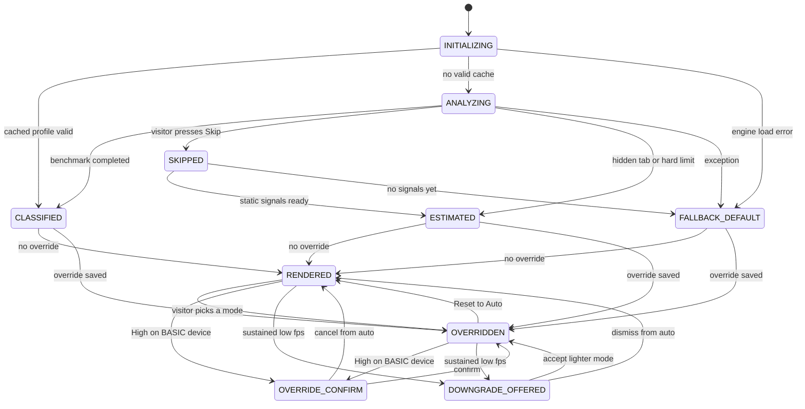
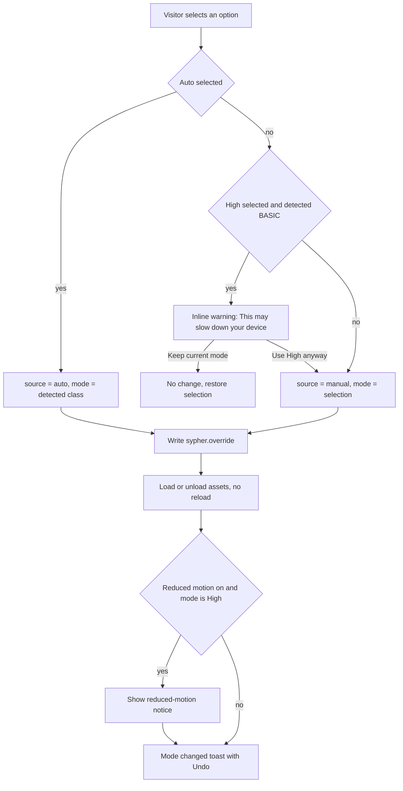

# Adaptive Web Experience System: System Workflow Document

**Client:** Sypher Creative Solutions (corporate website)
**Audience:** Frontend developers, backend (API) developer, QA, design team
**Stack assumption:** Plain HTML, CSS, and JavaScript with a small custom JSON API. Framework-agnostic.
**Conforms to:** Part 2 System Architecture (layers, components, data contracts, `data-mode` / `data-motion` / `data-source` hooks, `adaptive:*` events, `sypher.*` storage keys, four API endpoints). Anything not defined in Part 2 is marked **[Proposed addition]**.
**Status:** Specification. This document contains no production code. JSON appears only to define data contracts.

---

## Table of Contents

1. [System Overview](#1-system-overview)
2. [End-to-End Workflow](#2-end-to-end-workflow)
3. [State Machine](#3-state-machine)
4. [Detection and Scoring Logic](#4-detection-and-scoring-logic)
5. [Mode Behavior Matrix](#5-mode-behavior-matrix)
6. [Screen-by-Screen UI Specification](#6-screen-by-screen-ui-specification)
7. [Component Inventory for the Frontend](#7-component-inventory-for-the-frontend)
8. [Manual Override Flow and Accessibility Flow](#8-manual-override-flow-and-accessibility-flow)
9. [API Contract Summary](#9-api-contract-summary)
10. [Copy Deck](#10-copy-deck)
11. [Testing Plan and Log Template](#11-testing-plan-and-log-template)
12. [Documentation Report Mapping](#12-documentation-report-mapping)
13. [Assumptions, Risks, and Open Questions](#13-assumptions-risks-and-open-questions)
14. [Website Suggestions](#14-website-suggestions)

### Global constants used throughout this document

All of these live in configuration (the `scoring` and `timing` blocks of `modes.json`, see Section 9). They are not hard-coded in UI code.

| Constant | Value | Used by |
|---|---|---|
| `BENCHMARK_MAX_MS` | 2000 ms | FPS Benchmark |
| `BENCHMARK_WARMUP_MS` | 250 ms (frames in this window are discarded) | FPS Benchmark |
| `BENCHMARK_MIN_WINDOW_MS` | 1000 ms of post-warm-up sampling, or 30 sampled frames, whichever comes first | FPS Benchmark validity |
| `ANALYSIS_SKIP_VISIBLE_MS` | 800 ms after the Analysis Screen appears | Analysis Screen |
| `ANALYSIS_HARD_LIMIT_MS` | 2500 ms after the Analysis Screen appears | Mode Controller |
| `API_TIMEOUT_MS` | 1500 ms per request | API Client |
| `BATTERY_TIMEOUT_MS` | 300 ms for `navigator.getBattery()` to resolve | Signal Collector |
| `RESULT_BANNER_DISMISS_MS` | 6000 ms (paused while hovered or focused) | Result Banner |
| `TOAST_DISMISS_MS` | 6000 ms for info toasts; warning toasts do not auto-dismiss | Notices and Toasts |
| `PROFILE_TTL_MS` | 24 hours | Preference Store |
| `THRESHOLD_HIGH` | score >= 70 | Classifier |
| `THRESHOLD_MEDIUM` | score 40 to 69 | Classifier |
| `TOUCH_CAP_VIEWPORT_PX` | viewport width < 1024 CSS px | Classifier (mobile/touch cap) |
| `TOUCH_CAP_EXEMPT_FPS` | FPS >= 58 **and** WebGL2 available | Classifier (cap exemption) |
| `BATTERY_LOW_LEVEL` | level <= 0.20 and `charging === false` | Classifier (downgrade) |
| `LIVE_DOWNGRADE_FPS` | < 24 fps for 3 consecutive 1-second windows | Live Downgrade Watch |
| `LIVE_DOWNGRADE_GRACE_MS` | 5000 ms after first render (no sampling during this window) | Live Downgrade Watch |
| Breakpoints | Mobile 0 to 599 px; Tablet 600 to 1023 px; Desktop >= 1024 px (CSS px, viewport width) | Presentation layer |
| Minimum touch target | 44 x 44 CSS px (tablet and mobile); 32 x 32 CSS px minimum on desktop with 8 px spacing | Presentation layer |

---

## 1. System Overview

The Adaptive Web Experience System lets the Sypher Creative Solutions corporate website serve one set of content with three levels of visual complexity: **HIGH**, **MEDIUM**, and **BASIC**. The site always ships a BASIC-safe baseline (all text, links, images, and forms in plain HTML with `base.css`). A client-side JavaScript engine then reads coarse capability signals from the browser (CPU thread count, device memory, screen pixel load, WebGL support, and a short frame-rate benchmark), converts them to a 0 to 100 Device Performance Score, and classifies the device into exactly one class. It then applies caps (touch device on a small viewport; data saver, slow network, or low battery), respects any saved manual override, and enforces `prefers-reduced-motion`. The engine writes the result to three attributes on the `<html>` element (`data-mode`, `data-motion`, `data-source`) and fires `adaptive:*` events. CSS and UI modules respond only to those hooks, and load or unload heavy assets (background video, WebGL, animation libraries) on demand. A thin custom API confirms the classification, supplies the per-mode feature flags from `modes.json`, and stores test-device logs. The site never depends on the API: if the API is unreachable, the browser classifies locally and uses built-in default flags. The system never identifies a CPU or GPU model. It scores capability only.

### 1.1 Actors

| Actor | Type | Responsibility | Talks to |
|---|---|---|---|
| **Visitor** | Human | Views the site; may skip the analysis, open the Performance Dashboard, choose a manual override, accept or dismiss notices | UI Renderer |
| **Detection Engine** | Layer 2 JavaScript modules: Signal Collector, FPS Benchmark, Scoring Engine, Classifier, Accessibility Guard, Preference Store, Mode Controller, API Client | Collects signals, scores, classifies, resolves the final mode, sets root hooks, fires events, persists preferences | Browser APIs (Layer 3), Custom API, UI Renderer (through hooks and events only) |
| **Custom API** | Server: Custom API + Data Store | Confirms classification (`POST /api/device-profile`), serves mode flags (`GET /api/mode-config`), stores and lists test logs (`/api/test-results`) | Detection Engine (API Client) |
| **UI Renderer** | Layer 1: Analysis Screen, Result Banner, Site Sections, Performance Dashboard, Override Control, Notices and Toasts, styled by `base.css`, `mode-medium.css`, `mode-high.css` | Renders the presentation for the active `data-mode` and `data-motion`; captures user actions and sends them to the Mode Controller | Visitor, Detection Engine |

### 1.2 Layer summary (from Part 2)

```
+-------------------------------------------------------------------------+
| LAYER 1  PRESENTATION                                                   |
|  Analysis Screen | Result Banner | Site Sections | Performance Dashboard |
|  Override Control | Notices and Toasts                                  |
|  styled by: base.css (always) + mode-medium.css + mode-high.css         |
+-------------------------------^-----------------------------------------+
                                | <html data-mode data-motion data-source>
                                | adaptive:ready / adaptive:modechange / adaptive:notice
+-------------------------------+-----------------------------------------+
| LAYER 2  ADAPTIVE ENGINE                                                |
|  Signal Collector -> FPS Benchmark -> Scoring Engine -> Classifier      |
|  Accessibility Guard   Preference Store   Mode Controller   API Client <---> CUSTOM API
+-------------------------------^-----------------------------------------+     (JSON/HTTPS,
                                | raw signals                                    1.5 s timeout)
+-------------------------------+-----------------------------------------+
| LAYER 3  BROWSER APIs                                                   |
|  navigator.hardwareConcurrency | navigator.deviceMemory | window.screen  |
|  window.matchMedia | WebGL/WebGL2 | requestAnimationFrame                |
|  navigator.connection | navigator.getBattery | Page Visibility | storage |
+-------------------------------------------------------------------------+
```

---

## 2. End-to-End Workflow

### 2.1 Numbered steps (page open to final render)

Timings are measured from the moment the Analysis Screen appears (t = 0).

| Step | Name | Owner | What happens | Timing |
|---|---|---|---|---|
| 0 | **Baseline HTML paint** | Browser | `index.html` and `base.css` load. All content is present as plain HTML. `<html>` ships with `data-mode="basic" data-motion="full" data-source="auto"`. If JavaScript is disabled, the visitor sees the full BASIC site and the flow ends here (no Analysis Screen, because it is created by JavaScript). `base.css` also contains a CSS-only `@media (prefers-reduced-motion: reduce)` block as a backup guard. | Before JS |
| 1 | **Early Mode Bootstrap** **[Proposed addition]** | Inline script in `<head>` (under 1 KB) | Reads `sypher.override` and `sypher.profile` from localStorage (wrapped in try/catch). Reads `prefers-reduced-motion`. If a non-expired profile exists **and** this is the same browser session (`sessionStorage` key `sypher.session` present **[Proposed addition]**), it sets `data-mode` to the resolved mode before first paint to prevent a flash of the wrong mode, and marks the run as "cached". Otherwise it leaves `data-mode="basic"` and sets `data-adaptive-state="analyzing"` **[Proposed addition]** so CSS shows the Analysis Screen. | < 5 ms |
| 2 | **INITIALIZING** | Mode Controller | Loads engine modules with `defer`. Accessibility Guard sets `data-motion` (`reduced` if `prefers-reduced-motion: reduce` matches, otherwise `full`) and subscribes to changes of that media query. If the run is "cached", jump to Step 8 using the cached profile (no Analysis Screen, no benchmark). | ~0 to 50 ms |
| 3 | **Show Analysis Screen** | Analysis Screen | Overlay appears with "Analyzing Device Performance..." in an `aria-live="polite"` region and a determinate progress bar at 0%. Skip button is rendered but hidden; it becomes visible at t = 800 ms. | t = 0 |
| 4 | **Collect static signals** | Signal Collector | Reads `hardwareConcurrency`, `deviceMemory`, `screen.width/height/devicePixelRatio`, `matchMedia` queries (`prefers-reduced-motion`, `pointer: coarse`, `hover: hover`, viewport width), `navigator.connection` (`saveData`, `effectiveType`), and starts `navigator.getBattery()` with a 300 ms timeout. Every unavailable or invalid value is recorded as `null` and added to `missingSignals`. Progress goes to 20%. | t = 0 to ~50 ms |
| 5 | **WebGL check** | Signal Collector | Creates a detached canvas, requests `webgl2`, then `webgl`, then releases the context. Result: `"webgl2"`, `"webgl1"`, or `"none"`. If the check throws an exception, the result is `null` (missing), not `"none"`. Progress goes to 35%. | ~10 to 60 ms |
| 6 | **FPS Benchmark** | FPS Benchmark | Runs a fixed synthetic workload (Section 4.3) and samples `requestAnimationFrame` for up to 2000 ms. Discards the first 250 ms. Stops early if the tab becomes hidden (`visibilitychange`) or the visitor presses Skip. Progress moves from 35% to 90% in proportion to elapsed time. Result: FPS value, or `null` with `benchmark.completed = false`. | t = ~60 to 2060 ms |
| 7 | **Score** | Scoring Engine | Converts each available signal to points, excludes missing ones, rescales to 0 to 100, and returns the score plus a per-signal breakdown. Sets `estimated = true` if the benchmark did not complete or fewer than 3 of the 5 scored signals are available. Progress goes to 95%. | < 5 ms |
| 8 | **Classify and apply caps** | Classifier | Maps score to class (HIGH >= 70, MEDIUM 40 to 69, BASIC < 40). Applies, in order (Section 4.6): (a) insufficient-data rule, (b) estimated-HIGH guard, (c) mobile/touch cap, (d) constraint downgrade (data saver, slow network, low battery). Records triggered rules in `appliedCaps`. Progress goes to 100%. | < 5 ms |
| 8a | **API sync (parallel, non-blocking)** | API Client | Sends `POST /api/device-profile` with the signals payload. 1500 ms timeout. Does not delay Step 9. Response handling is defined in Step 12. | Starts at Step 8 |
| 9 | **Resolve final mode** | Mode Controller + Preference Store | Reads `sypher.override`. If it is `high`, `medium`, or `basic`, that value becomes the mode and `data-source="manual"`. If it is `auto`, missing, or unreadable, the detected class becomes the mode and `data-source="auto"`. Reduced motion does not change the mode; it only keeps `data-motion="reduced"`. | < 1 ms |
| 10 | **Apply mode** | Mode Controller | Sets `data-mode`, `data-motion`, `data-source` on `<html>`. Applies the built-in default flags for the mode immediately, then requests `GET /api/mode-config?mode=<mode>` (cacheable). Loads `mode-medium.css` (MEDIUM and HIGH) and `mode-high.css` (HIGH) with `<link rel="stylesheet">` insertion; dynamically imports heavy modules only if the active flags enable them. Writes `sypher.profile` (score, class, timestamp) and `sypher.session`. Removes `data-adaptive-state`. | < 50 ms, assets stream afterwards |
| 11 | **Render and announce** | Analysis Screen, Result Banner | Analysis Screen fades out (150 ms opacity; instant under `data-motion="reduced"`) and is removed from the DOM. Result Banner shows "Device Performance Level: <CLASS>" and the explanation line, announced via `aria-live="polite"`. Focus is **not** moved; it stays at the top of the document so the skip link is the first tab stop. Fires `adaptive:ready { mode, score, source }` once. If any caps, fallbacks, or reduced-motion conditions apply, fires `adaptive:notice` for each. | t <= 2500 ms |
| 12 | **Reconcile API response** | API Client, Mode Controller | If the `POST /api/device-profile` response arrives within 1500 ms: store `confirmed: true` in the profile, merge returned flags. If the server class differs from the local class **and** `data-source="auto"`, apply the server class (fires `adaptive:modechange`) and update the Result Banner text if it is still visible. If the request fails or times out: keep the local result, set API status to offline, show nothing to regular visitors (dashboard shows "Detection source: Local (server unavailable)"). | t <= Step 8 + 1500 ms |
| 13 | **Steady state** | All | Site Sections render the active mode. The visitor can open the Performance Dashboard and use the Override Control at any time. The Live Downgrade Watch starts 5000 ms after render in HIGH and MEDIUM. | Ongoing |

### 2.2 Text flowchart (all decision branches)

```
[Page open]
    |
    v
<JavaScript enabled?> --no--> [Render BASIC baseline, all content, CSS reduced-motion guard] --> END
    | yes
    v
[Early Mode Bootstrap: read sypher.override, sypher.profile, prefers-reduced-motion]
    |
    v
<localStorage readable?> --no--> [Treat override = auto, no cached profile; continue]
    | yes                                   |
    v                                       v
<Same session AND profile age < 24 h?> --yes--> [Use cached profile] -----------------------+
    | no                                                                                  |
    v                                                                                     |
[Show Analysis Screen, announce "Analyzing Device Performance..."]                        |
    |                                                                                     |
    v                                                                                     |
[Collect static signals]                                                                  |
    |-- hardwareConcurrency valid integer >= 1? --no--> cpu = null (missing)               |
    |-- deviceMemory valid number > 0?          --no--> memory = null (missing)            |
    |-- screen width/height/DPR valid?          --no--> try innerWidth/innerHeight;        |
    |                                                   still invalid -> screen = null     |
    |-- matchMedia available?                   --no--> pointerCoarse = null,              |
    |                                                   reducedMotion = false (CSS guard   |
    |                                                   still applies)                     |
    |-- navigator.connection available?         --no--> saveData = null, effectiveType = null
    |-- getBattery resolves in 300 ms?          --no--> battery = null                     |
    v                                                                                     |
[WebGL check] -- throws? --yes--> webgl = null (missing)                                  |
    | no -> "webgl2" | "webgl1" | "none"                                                  |
    v                                                                                     |
[FPS Benchmark, max 2000 ms]                                                              |
    |-- tab hidden during run?     --yes--> stop; fps = null; benchmark.completed = false  |
    |-- visitor pressed Skip?      --yes--> stop; fps = null; benchmark.completed = false  |
    |-- 2500 ms hard limit hit?    --yes--> stop; fps = null; benchmark.completed = false  |
    |-- valid window reached?      --no--> fps = null; benchmark.completed = false         |
    | yes -> fps = measured value; benchmark.completed = true                             |
    v                                                                                     |
<Any exception in Steps 4 to 7?> --yes--> [FALLBACK_DEFAULT: class = MEDIUM, notice]  ----+
    | no                                                                                  |
    v                                                                                     |
[Score: points for available signals, rescaled to 0..100]                                 |
    |                                                                                     |
    v                                                                                     |
<Benchmark completed?> --no--> estimated = true                                           |
    v                                                                                     |
<Available scored signals >= 3?> --no--> estimated = true;                                |
    |                                      <fps also missing?> --yes--> class = MEDIUM    |
    |                                                                    (insufficient data)
    v yes                                                                                 |
[Class from score: >=70 HIGH | 40..69 MEDIUM | <40 BASIC]                                 |
    |                                                                                     |
    v                                                                                     |
<fps missing AND class = HIGH AND score < 80?> --yes--> class = MEDIUM (estimatedHighGuard)
    |                                                                                     |
    v                                                                                     |
<pointerCoarse AND viewport < 1024 px AND class = HIGH?>                                  |
    |-- yes --> <fps >= 58 AND webgl = "webgl2"?> --yes--> keep HIGH, label "benchmark-verified"
    |                                             --no--> class = MEDIUM, appliedCaps += touchCap
    v no                                                                                  |
<saveData = true OR effectiveType in {slow-2g, 2g} OR battery <= 20% not charging?>       |
    |-- yes --> class = one level lower (floor BASIC), appliedCaps += reason(s); max 1 level
    v no                                                                                  |
[Detected class final] <---------------------------------------------------------------+
    |
    +----> (parallel) [POST /api/device-profile, 1500 ms timeout]
    |                   |-- success, class differs, source = auto --> apply server class
    |                   |-- success, same class or source = manual --> store confirmed flag only
    |                   |-- 4xx/5xx/timeout/offline --> keep local result, apiStatus = offline
    v
<sypher.override in {high, medium, basic}?>
    |-- yes --> mode = override, data-source = manual
    |            <override = high AND detected = BASIC?> --yes--> show slow-device warning notice
    |-- no  --> mode = detected class (lowercase), data-source = auto
    v
<prefers-reduced-motion: reduce?>
    |-- yes --> data-motion = reduced (all non-essential motion off, any mode)
    |            <mode = high?> --yes--> show reduced-motion notice
    |-- no  --> data-motion = full
    v
[Set data-mode, data-motion, data-source; apply built-in flags; GET /api/mode-config]
    |-- mode-config success --> merge server flags, load/unload assets for changed flags
    |-- mode-config failure --> keep built-in flags
    v
[Hide Analysis Screen, show Result Banner, fire adaptive:ready]
    |
    v
[Steady state: dashboard, override, live downgrade watch] --> END
```

### 2.3 Mermaid flowchart (same logic)

```mermaid
flowchart TD
    pageOpen[Page open] --> jsCheck{JavaScript enabled}
    jsCheck -->|no| basicOnly[Render BASIC baseline only]
    jsCheck -->|yes| bootstrap[Early Mode Bootstrap]
    bootstrap --> cacheCheck{"Same session and profile under 24 h"}
    cacheCheck -->|yes| cached[Use cached profile]
    cacheCheck -->|no| analysis["Show Analysis Screen"]
    analysis --> collect[Collect static signals]
    collect --> missingMark["Mark unavailable signals as missing"]
    missingMark --> webgl[WebGL check]
    webgl --> bench["FPS Benchmark up to 2000 ms"]
    bench --> benchOk{"Benchmark completed"}
    benchOk -->|"no: hidden, skip, limit"| estFlag["fps missing, estimated = true"]
    benchOk -->|yes| fpsVal[FPS value recorded]
    estFlag --> errCheck{"Exception during detection"}
    fpsVal --> errCheck
    errCheck -->|yes| fallback["FALLBACK_DEFAULT: MEDIUM"]
    errCheck -->|no| score["Score and rescale to 0-100"]
    score --> enough{"At least 3 scored signals"}
    enough -->|"no and fps missing"| insufficient["MEDIUM, estimated"]
    enough -->|yes| classify{"Score band"}
    classify -->|"70 or more"| high[HIGH]
    classify -->|"40 to 69"| medium[MEDIUM]
    classify -->|"under 40"| basic[BASIC]
    high --> estGuard{"fps missing and score under 80"}
    estGuard -->|yes| capMedium
    estGuard -->|no| touchCap{"Coarse pointer and viewport under 1024"}
    touchCap -->|"yes, not verified"| capMedium["Cap to MEDIUM"]
    touchCap -->|"no, or verified"| constraint
    capMedium --> constraint{"Save-Data, 2g, or low battery"}
    medium --> constraint
    basic --> constraint
    insufficient --> constraint
    constraint -->|yes| downgrade["Lower one level, floor BASIC"]
    constraint -->|no| detected[Detected class]
    downgrade --> detected
    fallback --> detected
    cached --> detected
    detected --> apiSync["POST device-profile in parallel"]
    apiSync -->|"fail or timeout"| localKeep[Keep local result]
    apiSync -->|"success, differs, auto"| serverApply[Apply server class]
    detected --> overrideCheck{"Saved manual override"}
    overrideCheck -->|yes| manualMode["mode = override, source = manual"]
    overrideCheck -->|no| autoMode["mode = detected, source = auto"]
    manualMode --> motionCheck{"prefers-reduced-motion reduce"}
    autoMode --> motionCheck
    motionCheck -->|yes| motionReduced["data-motion = reduced"]
    motionCheck -->|no| motionFull["data-motion = full"]
    motionReduced --> applyMode["Set root hooks, apply flags, GET mode-config"]
    motionFull --> applyMode
    applyMode --> render["Hide analysis, show Result Banner, adaptive:ready"]
    render --> steady["Steady state: dashboard, override, live downgrade watch"]
```



---

## 3. State Machine

### 3.1 State list

The engine is in exactly one **primary state** at a time. API connectivity is tracked separately as an **orthogonal status** (`apiStatus`) because it never blocks the primary flow.

| State | Entry condition | Exit condition and next state | What the UI shows | Root hooks / events |
|---|---|---|---|---|
| `INITIALIZING` | Engine script starts executing (after Early Mode Bootstrap) | Cached profile valid for this session: to `CLASSIFIED`. Otherwise: to `ANALYZING`. Fatal error loading engine: to `FALLBACK_DEFAULT`. | Baseline BASIC content. No overlay yet. | `data-mode="basic"` (or cached mode), `data-motion` set |
| `ANALYZING` | No valid cached profile for this session | Benchmark completed and scoring finished: to `CLASSIFIED`. Visitor presses Skip: to `SKIPPED`. Tab hidden or 2500 ms hard limit or benchmark invalid: to `ESTIMATED`. Exception: to `FALLBACK_DEFAULT`. | Analysis Screen overlay: "Analyzing Device Performance...", progress bar 0 to 100%, Skip button visible from 800 ms. Page content underneath is present but `inert` while the overlay is shown. | `data-adaptive-state="analyzing"` **[Proposed addition]**; `adaptive:progress { step, percent }` **[Proposed addition]** |
| `SKIPPED` | Visitor activates Skip during `ANALYZING` | Immediately (same frame): benchmark stopped. If static signals are collected: to `ESTIMATED`. If static collection had not finished: to `FALLBACK_DEFAULT`. | Overlay closes immediately (no fade). | none |
| `ESTIMATED` | Benchmark did not complete (hidden tab, Skip, hard limit, invalid window) or fewer than 3 scored signals available | Classification computed from static signals: to `RENDERED` (auto) or `OVERRIDDEN` (manual override saved) | Result Banner adds the line "Result estimated from limited information." Dashboard shows an "Estimated" badge next to the score. | Profile `estimated: true` |
| `CLASSIFIED` | Score and class computed with completed benchmark, or cached profile loaded | Saved override is `auto` or missing: to `RENDERED`. Saved override is `high`, `medium`, or `basic`: to `OVERRIDDEN`. | Progress bar at 100% for at most 150 ms, then overlay closes. | none |
| `FALLBACK_DEFAULT` | Detection threw an exception, engine module failed to load, or Skip occurred before any signal was collected | Mode set to MEDIUM (or saved override if present): to `RENDERED` or `OVERRIDDEN` | Result Banner: "Device Performance Level: MEDIUM" plus "We couldn't analyze your device, so a balanced mode is being used." Dashboard fields show "Not available"; score shows "Not available". | Profile `class: "MEDIUM"`, `source: "fallback"` in profile (root `data-source="auto"`) |
| `RENDERED` | Final mode resolved from detection (`source = auto`) | Visitor selects High, Medium, or Basic: to `OVERRIDDEN` (or to `OVERRIDE_CONFIRM` if High on a BASIC device). Live Downgrade Watch triggers: to `DOWNGRADE_OFFERED`. API returns a different class: stays `RENDERED` with the new mode. | Site in detected mode. Result Banner visible until dismissed or 6000 ms. Performance chip shows "<Mode> - Auto". | `data-source="auto"`; `adaptive:ready` (first time only), `adaptive:modechange` on any later change |
| `OVERRIDE_CONFIRM` **[Proposed addition]** | Visitor selects High while detected class is BASIC | "Use High anyway": to `OVERRIDDEN` (High). "Keep current mode" or Esc: back to the previous state with no change. | Inline warning inside the Override Control: "This may slow down your device." with two buttons. Mode is not yet changed. | none |
| `OVERRIDDEN` | Visitor chose a manual mode, or a saved manual override was restored, or visitor accepted a live-downgrade offer | Visitor chooses "Reset to Auto" or the Auto option: to `RENDERED` with the detected class. Visitor chooses another manual mode: stays `OVERRIDDEN`. Live Downgrade Watch triggers: to `DOWNGRADE_OFFERED`. | Site in manual mode. Chip shows "<Mode> - Manual". Dashboard shows "Detected: <CLASS>, Using: <MODE> (manual)" when they differ, with a "Reset to Auto" button. | `data-source="manual"`; `adaptive:modechange { mode, source: "manual" }` |
| `DOWNGRADE_OFFERED` | In HIGH or MEDIUM, after the 5000 ms grace period, FPS < 24 in 3 consecutive 1-second windows while the tab is visible, and the offer has not been dismissed this session | "Switch to <lighter mode>": to `OVERRIDDEN` with the next lighter mode. "Keep <current mode>", close, or 10 s without action: back to the previous state; no further offers this session. | Warning toast with two actions (Section 6.13). | `adaptive:notice { type: "downgrade-offer" }` |

**Orthogonal status `apiStatus`:** `unknown` (initial), `online` (any API call succeeded), `offline` (last call failed or timed out). Effects: dashboard "Detection source" line, mode-config flags source, and the test-results retry notice. `apiStatus` never changes the primary state.

### 3.2 Text state diagram

```
                     +----------------+
                     |  INITIALIZING  |
                     +----------------+
               cached |      | no cache       | engine load error
                      |      v                v
                      |  +-----------+    +------------------+
                      |  | ANALYZING |--->| FALLBACK_DEFAULT |
                      |  +-----------+ err+------------------+
                      |   |   |    |                 |
                      |   |   |Skip|hidden/limit     |
                      |   |   v    v                 |
                      |   | +---------+  +---------+ |
                      |   | | SKIPPED |->|ESTIMATED| |
                      |   | +---------+  +---------+ |
                      |   | done              |      |
                      v   v                   |      |
                   +------------+             |      |
                   | CLASSIFIED |             |      |
                   +------------+             |      |
               auto  |        | manual saved  |      |
                     v        v               v      v
              +----------+  pick mode   +------------+
              | RENDERED |------------->| OVERRIDDEN |
              |  (auto)  |<-------------| (manual)   |
              +----------+ Reset to Auto+------------+
                |   ^  | High on BASIC      ^   |
                |   |  v                    |   |
                |   | +------------------+  |   |
                |   +-| OVERRIDE_CONFIRM |--+   |
                |cancel+------------------+confirm
                | low fps                       | low fps
                v                               v
              +------------------------------------+
              |         DOWNGRADE_OFFERED          |
              +------------------------------------+
                 dismiss: back to previous state
                 accept:  OVERRIDDEN (lighter mode)

  Orthogonal: apiStatus = unknown | online | offline (never blocks)
```

### 3.3 Mermaid state diagram



Note: in the Mermaid diagram, "cancel" from `OVERRIDE_CONFIRM` and "dismiss" from `DOWNGRADE_OFFERED` return to whichever state the visitor came from (`RENDERED` or `OVERRIDDEN`); only the `RENDERED` return edge is drawn to keep the diagram readable.

### 3.4 Events emitted per transition

| Transition | Event | Payload |
|---|---|---|
| Any state to first `RENDERED` or `OVERRIDDEN` | `adaptive:ready` (once per page load) | `{ mode, score, source }` (`score` is `null` in `FALLBACK_DEFAULT`) |
| Any later change of `data-mode` or `data-source` | `adaptive:modechange` | `{ mode, source }` |
| Entering `ESTIMATED`, `FALLBACK_DEFAULT`, `OVERRIDDEN` with High on BASIC, reduced motion with High, cap applied, `DOWNGRADE_OFFERED`, API test-save failure | `adaptive:notice` | `{ type, message }` where `type` is one of the values in Section 10.6 |
| Progress during `ANALYZING` | `adaptive:progress` **[Proposed addition]** | `{ step: "signals" or "webgl" or "benchmark" or "scoring" or "done", percent: 0..100 }` |
| API confirmation changes profile fields | `adaptive:profileupdate` **[Proposed addition]** | Full profile result object (Section 9.2) |

---

## 4. Detection and Scoring Logic

### 4.1 Signal inventory and fallbacks

| Signal | Source API | How it is read | Valid value | Unavailable / invalid when | Fallback | Dashboard display when missing | Scored? |
|---|---|---|---|---|---|---|---|
| CPU threads | `navigator.hardwareConcurrency` | Read once | Integer 1 to 256 | `undefined`, `0`, non-integer, or outside range | `cpu = null`; excluded from score; added to `missingSignals` | "Not available" | Yes (25) |
| Device memory | `navigator.deviceMemory` | Read once. Chromium rounds to 0.25, 0.5, 1, 2, 4, 8 and caps at 8. Not exposed in Safari or Firefox. | Number > 0 and <= 64 | `undefined` (Safari, Firefox), `0`, non-number | `memory = null`; excluded; `missingSignals` | "Not available" | Yes (20) |
| Screen | `window.screen.width`, `.height`, `window.devicePixelRatio` | Read once; width and height are CSS pixels | width and height 1 to 16384; DPR 0.5 to 8 | `0`, `undefined`, or out of range | Try `window.innerWidth` / `innerHeight`. If still invalid, `screen = null`; excluded | "Not available" | Yes (10) |
| WebGL | Detached `<canvas>`: `getContext("webgl2")`, then `getContext("webgl")` | Context released immediately after the check | `"webgl2"`, `"webgl1"`, `"none"` | The check throws an exception (blocked by policy or extension) | `webgl = null`; excluded. Note: a `null` context with no exception is a valid `"none"` and scores 0. | "Not available" (exception) or "Not supported" (`"none"`) | Yes (15) |
| FPS | `requestAnimationFrame` benchmark (Section 4.3) | Up to 2000 ms | Number 1 to 500 | Tab hidden, Skip pressed, 2500 ms hard limit hit, valid window not reached | `fps = null`; excluded; `estimated = true` | "Not measured (estimated result)" | Yes (30) |
| Reduced motion | `matchMedia("(prefers-reduced-motion: reduce)")` | Read once, then listen for `change` | Boolean | `matchMedia` missing | Treat as `false` in JS; the CSS `@media` guard in `base.css` still applies | "Not available" | No (motion only) |
| Coarse pointer | `matchMedia("(pointer: coarse)")` | Read once | Boolean | `matchMedia` missing | `pointerCoarse = null`; mobile/touch cap not applied | "Not available" | No (cap input) |
| Hover capability | `matchMedia("(hover: hover)")` | Read once, listen for change | Boolean | `matchMedia` missing | Treat as `false` (no hover-dependent UI) | Not shown | No (UI only) |
| Viewport width | `window.innerWidth` (CSS px) | Read at detection; listen to `resize` for layout only | Integer > 0 | Never missing in practice | n/a | Shown as part of Screen | No (cap input) |
| Save-Data | `navigator.connection.saveData` | Read once | Boolean | `navigator.connection` missing (Safari, Firefox) | `saveData = null`; downgrade rule ignores it | "Not available" | No (downgrade input) |
| Network type | `navigator.connection.effectiveType` | Read once | `"slow-2g"`, `"2g"`, `"3g"`, `"4g"` | Missing | `effectiveType = null`; ignored | "Not available" | No (downgrade input) **[Proposed addition]** |
| Battery | `navigator.getBattery()` | Promise with 300 ms timeout | `level` 0 to 1, `charging` boolean | API missing (Safari, Firefox), rejected, or timeout | `battery = null`; `batteryLowNotCharging = false` | "Not available" | No (downgrade input) |
| Navigation timing | `performance.getEntriesByType("navigation")` | Read after load, for the test log only | `responseEnd`, `domContentLoadedEventEnd` | Missing | Omitted from log | Shown only in debug view | No |

All reads are wrapped so a thrown exception from any single signal records that signal as missing and does not stop collection of the others.

### 4.2 Scoring table

| Signal | Max points | Rule (value to points) |
|---|---|---|
| CPU threads (`cpu`) | 25 | >= 12: **25**; 8 to 11: **20**; 6 to 7: **15**; 4 to 5: **9**; 2 to 3: **4**; 1: **0** |
| Device memory (`memory`, GB) | 20 | >= 8: **20**; 4 to < 8: **12**; 2 to < 4: **6**; < 2: **0**. Values between steps (0.5, 1.5, 3, 6) take the step at or below the value. |
| Screen pixel load (`screen`) | 10 | Physical pixels = `width x height x DPR x DPR`. <= 2.1 MP (about 1920 x 1080 at DPR 1): **10**; > 2.1 to 4.2 MP: **8**; > 4.2 to 8.3 MP (about 4K): **5**; > 8.3 MP: **2**. **Headroom penalty:** if physical pixels > 2.1 MP **and** (`cpu` <= 4 **or** `memory` <= 4), subtract **3** (minimum 0). The penalty uses only the signals that are available. |
| WebGL (`webgl`) | 15 | `"webgl2"`: **15**; `"webgl1"`: **8**; `"none"`: **0** |
| FPS benchmark (`fps`) | 30 | >= 55: **30**; 45 to < 55: **22**; 30 to < 45: **12**; < 30: **3** |
| **Total** | **100** | |

### 4.3 FPS Benchmark procedure

1. Workload: a decorative canvas inside the Analysis Screen (320 x 180 CSS px, backing store scaled by `min(DPR, 2)`). Every frame it clears and draws 150 semi-transparent circles moving along fixed paths. The workload is identical on every device so results are comparable.
2. Under `data-motion="reduced"`, the same canvas is drawn but sits behind the opaque analysis card (it is still rendered but not visible), so the visitor sees no motion.
3. Timing: start at `t0`. Ignore frames before `t0 + 250 ms`. Count frames and time from the first counted frame to the last.
4. `fps = (countedFrames - 1) / (lastFrameTime - firstFrameTime) x 1000`.
5. **Valid** when either 1000 ms of post-warm-up sampling elapsed or 30 frames were counted, without the tab becoming hidden. Then `benchmark.completed = true` and the run stops at 2000 ms total.
6. **Invalid** when the tab becomes hidden (`document.visibilityState = "hidden"`), Skip is pressed, or the 2500 ms hard limit arrives first. Then `fps = null`, `benchmark.completed = false`.
7. `benchmark.durationMs` is recorded in both cases.
8. The canvas is removed from the DOM after the benchmark, and its context is released.

### 4.4 Rescaling around missing signals

```
availableMax = sum of max points of every scored signal whose value is not null
earned       = sum of points earned by those signals
score        = round( earned / availableMax x 100 )
```

- Missing signals are **excluded**, never scored as zero.
- If `availableMax = 0` (no scored signals at all), the Classifier goes to `FALLBACK_DEFAULT` (MEDIUM).
- The per-signal breakdown keeps raw points (`breakdown.memory = null` when missing) so the dashboard can show "Not available" instead of 0.

### 4.5 Classification thresholds

| Class | Score |
|---|---|
| HIGH | >= 70 |
| MEDIUM | 40 to 69 |
| BASIC | < 40 |

### 4.6 Rules applied after the score band (in this exact order)

| Order | Rule ID (`appliedCaps` value) | Condition | Effect |
|---|---|---|---|
| 1 | `insufficientData` | Fewer than 3 of the 5 scored signals available **and** `fps` is null | Class = MEDIUM regardless of score; `estimated = true` |
| 2 | `estimatedHighGuard` **[Proposed addition]** | `fps` is null **and** score band is HIGH **and** score < 80 | Class = MEDIUM. Reason: without a frame-rate test, HIGH requires a stronger static score. |
| 3 | `touchCap` | `pointerCoarse = true` **and** viewport width < 1024 px **and** class = HIGH | Class = MEDIUM, **unless** `fps >= 58` **and** `webgl = "webgl2"`, in which case HIGH is kept and `benchmarkVerified = true` (dashboard label "HIGH (benchmark-verified)"). If `pointerCoarse` is null, this rule is skipped. |
| 4 | `saveData`, `slowNetwork`, `lowBattery` | `saveData = true`; or `effectiveType` is `"slow-2g"` or `"2g"`; or battery level <= 0.20 **and** not charging | Class drops **one** level (HIGH to MEDIUM, MEDIUM to BASIC, BASIC stays BASIC). If several conditions are true, the class still drops only one level; every true condition is recorded in `appliedCaps`. |
| 5 | (reduced motion) | `prefers-reduced-motion: reduce` | Does **not** change class or mode. Sets `data-motion="reduced"` (Section 8.2). |

Only rules whose condition was met **and** that changed the class are listed in `appliedCaps`, except rule 4, which lists every true constraint even when the class was already BASIC (so the dashboard can explain it).

**Estimated flag:** `estimated = true` when `benchmark.completed = false` **or** fewer than 3 scored signals were available.

**Safe default:** if detection fails entirely (exception, engine load failure, `availableMax = 0`, or Skip before any signal was collected), class = MEDIUM, `source = "fallback"`, and the visitor is told (copy ID `RES-FALLBACK`).

### 4.7 "Why this mode?" explanation logic

The dashboard and Result Banner show one plain-language line built from the profile:

1. If any `appliedCaps` entry exists, name the first one (copy IDs `WHY-CAP-*`).
2. Otherwise, for HIGH: name the two signals with the highest ratio of earned to max points. For MEDIUM and BASIC: name the two signals with the lowest ratio.
3. Ties are broken by max points, highest first (FPS, CPU, memory, WebGL, screen).
4. Missing signals are never named as a reason.
5. If `estimated = true`, append "(estimated)".

### 4.8 Worked examples

**Example A: HIGH (gaming desktop, Chrome on Windows)**

| Signal | Value | Points |
|---|---|---|
| CPU threads | 16 | 25 / 25 |
| Device memory | 8 GB (Chromium cap) | 20 / 20 |
| Screen | 2560 x 1440 at DPR 1 = 3.69 MP | 8 / 10 (no penalty: CPU 16, memory 8) |
| WebGL | webgl2 | 15 / 15 |
| FPS | 60 (benchmark completed) | 30 / 30 |
| **Score** | 98 / 100 = **98** | Band: HIGH |

Rules: `pointerCoarse = false` (no touch cap); `saveData = false`; battery not available. **Detected: HIGH.** `estimated = false`, `appliedCaps = []`. Result Banner: "Device Performance Level: HIGH" / "Full visual effects enabled." Why line: "Strong processor and a smooth frame rate."

**Example B: MEDIUM (office laptop, Safari on macOS, memory missing)**

| Signal | Value | Points |
|---|---|---|
| CPU threads | 8 | 20 / 25 |
| Device memory | Not available (Safari) | excluded |
| Screen | 1440 x 900 at DPR 2 = 2880 x 1800 = 5.18 MP | 5 / 10 (no penalty: CPU 8, memory unknown) |
| WebGL | webgl2 | 15 / 15 |
| FPS | 40 (benchmark completed) | 12 / 30 |
| **Score** | earned 52 / available 80 = 0.65 = **65** | Band: MEDIUM |

Rules: 4 of 5 signals present, benchmark completed, so `estimated = false`; `pointerCoarse = false`; `navigator.connection` and battery not available, so the downgrade rule is skipped. **Detected: MEDIUM.** Dashboard: Memory "Not available". Why line: "A lower frame rate in the quick test and a very high-resolution screen."

**Example C: BASIC (budget Android phone, Chrome, Data Saver on)**

| Signal | Value | Points |
|---|---|---|
| CPU threads | 8 | 20 / 25 |
| Device memory | 2 GB | 6 / 20 |
| Screen | 393 x 873 at DPR 2.75 = about 1081 x 2401 = 2.60 MP | 8 - 3 = 5 / 10 (penalty: > 2.1 MP and memory <= 4) |
| WebGL | webgl2 | 15 / 15 |
| FPS | 27 (benchmark completed) | 3 / 30 |
| **Score** | 49 / 100 = **49** | Band: MEDIUM |

Rules: rule 3 (touch cap) does not change anything because the class is not HIGH. Rule 4: `saveData = true`, so MEDIUM drops to BASIC; `appliedCaps = ["saveData"]`. **Detected: BASIC.** Result Banner: "Device Performance Level: BASIC" / "Visual effects have been reduced to improve performance." Why line: "Data Saver is on."

**Example D (supplementary): HIGH on a phone (recent flagship phone, Safari on iOS)**

CPU 6 threads (15/25), memory not available, screen 393 x 852 at DPR 3 = 3.01 MP (8/10, no penalty because CPU > 4), WebGL2 (15/15), FPS 60 (30/30). Score = 68 / 80 = **85**, band HIGH. Touch cap condition is met (coarse pointer, viewport 393 px), but FPS >= 58 and WebGL2 is available, so HIGH is kept with `benchmarkVerified = true`. This proves screen size and performance class are independent.

**Example E (supplementary): Skip pressed on the gaming desktop from Example A**

FPS missing. Score = (25 + 20 + 8 + 15) / 70 = 97. Rule 2: score >= 80, so HIGH is kept. `estimated = true`. Result Banner adds "Result estimated from limited information."

---

## 5. Mode Behavior Matrix

This table is the frontend's source of truth. Every row is controlled by a flag in `modes.json` (Part 2 flags are unmarked; new flags are marked **[P]** = **[Proposed addition]**). The "Reduced motion" column applies on top of **any** mode when `data-motion="reduced"`.

| # | Feature | Flag | HIGH | MEDIUM | BASIC | Reduced motion (any mode) |
|---|---|---|---|---|---|---|
| 1 | Hero background | `videoBackground`, `heroMedia` [P] | `videoBackground: true`, `heroMedia: "video"`: muted looping background video (<= 15 s loop, WebM + MP4, <= 4 MB, 1080p max), poster image shown until the first frame plays | `heroMedia: "gradient-poster"`: static poster image with a slow CSS-only gradient overlay | `heroMedia: "static-image"`: static image (<= 960 px wide WebP), or brand solid color `--color-brand-dark` if the image fails | Poster image only; no video, no gradient animation |
| 2 | Animated backgrounds | `animatedBackground` [P] | `"webgl"`: ambient gradient field behind the services band and closing call-to-action band | `"css-gradient"`: background-position animation, 20 s cycle, `transform`/`opacity` or `background-position` only | `"none"`: flat brand color | `"none"` (static first frame) |
| 3 | WebGL / 3D | `webglScene` | `true`: WebGL module dynamically imported after first render | `false` | `false` (module never downloaded) | `false`; static image of the scene |
| 4 | Cursor effects | `cursorEffects` | `true` only when `(hover: hover)` and `(pointer: fine)` match: cursor-follow highlight on cards | `false` | `false` | `false` |
| 5 | Parallax | `parallax` | `true`: hero and section images move at 0.85x scroll speed | `false` | `false` | `false` |
| 6 | Hover effects | `hoverEffects` [P] | `"tilt-preview"`: card tilt <= 6 degrees, preview image or muted clip | `"lift"`: translateY(-4 px) and shadow, 150 ms | `"color"`: underline and color change only | `"color"` |
| 7 | Page transitions | `pageTransitions` | `"view-transition"`: cross-page transition with View Transitions API where supported, 300 ms; otherwise `"simple-fade"` | `"simple-fade"`: 200 ms opacity fade | `"none"`: instant navigation | `"none"` (instant) |
| 8 | Scroll animations | `scrollAnimations` | `"full"`: scroll-linked reveals (fade plus 24 px translate), staggered 60 ms, started by IntersectionObserver | `"reduced"`: single 300 ms fade-in per section, no stagger | `"none"`: content simply appears | `"none"` |
| 9 | Headline / typography | `headlineAnimation` [P] | `"reveal"`: word-by-word reveal once, 600 ms total | `"fade"`: 300 ms fade once | `"none"` | `"none"` |
| 10 | Icons and illustrations | `iconAnimation` [P] | `"animated-svg"`: CSS-animated SVG once on reveal; Lottie only if already imported for HIGH | `"static-svg"` | `"static-svg"` | `"static-svg"` |
| 11 | Hero autoplay | `autoplayVideo` | `true`: hero background video only, muted, `playsinline`, pauses when off-screen or tab hidden | `false` | `false` | `false` |
| 12 | Promotional videos and video banners | `videoBanners` [P] | `"inview-muted"`: muted preview loop plays when >= 50% visible; full video with sound only on Play click | `"poster-click"`: poster image plus Play button; `preload="none"`; video file loads on click | `"poster-link"`: poster image plus "Watch video (duration)" link that opens a lightweight player on click, plus a visible transcript link | `"poster-click"` (no preview loop) |
| 13 | Portfolio gallery | `galleryImages` | `"full"`: srcset up to 2560 w, AVIF, hover preview, lightbox with 300 ms zoom | `"optimized"`: srcset up to 1600 w, AVIF/WebP quality 70, caption reveal on hover/focus, lightbox with fade | `"thumbnail"`: 480 w thumbnails (WebP quality 60), title below, link to full case study page; lightbox opens instantly at <= 1280 w | Lightbox opens instantly; no zoom |
| 14 | Testimonials | `testimonials` | `"carousel"`: auto-advance every 7 s, pauses on hover, focus, and tab hidden; Pause button always visible | `"simple-slider"`: manual previous/next buttons, no auto-advance, 200 ms slide | `"static-list"`: all testimonials stacked as a list | Carousel without auto-advance (behaves like `"simple-slider"` with instant change) |
| 15 | Dynamic content sections | `dynamicSections` [P] | `"lazy-animated"`: lazy-loaded via IntersectionObserver (200 px root margin) with reveal | `"lazy-plain"`: lazy-loaded, no animation | `"static"`: content is in the initial HTML, images use `loading="lazy"` only | `"lazy-plain"` or `"static"` (no animation) |
| 16 | Navigation | `navigation` [P] | `"full"`: sticky header, hide on scroll down / show on scroll up (200 ms), Services and Portfolio mega-menu with thumbnails | `"full-lite"`: sticky header (always visible), text-only dropdown menus | `"simplified"`: sticky header, plain top-level links, no dropdowns; sub-pages are listed on each section landing page | Sticky header without hide/show animation |
| 17 | Layout | (CSS only) | Same grid and content order in all modes. HIGH may use overlapping decorative layers. | Same grid, no overlapping decorative layers | Same grid, single-column fallbacks where layers were removed | Same as mode |
| 18 | Fonts | `webFonts` [P] | `"brand-3"`: subsetted WOFF2, 3 weights, `font-display: swap`, metric-matched fallback | `"brand-2"`: subsetted WOFF2, 2 weights | `"system"`: system font stack, no font download | Same as mode |
| 19 | Image formats and sizes | `imageMaxWidth` [P] | 2560 px | 1600 px | 960 px (thumbnails 480 px) | Same as mode |
| 20 | Concurrent animations | `maxConcurrentAnimations` | 8 | 3 | 1 (only essential state feedback, for example focus or button press) | 0 looping animations; essential state change only (instant or <= 150 ms fade) |
| 21 | Live downgrade watch | `liveDowngradeWatch` [P] | `true` | `true` | `false` | Same as mode |
| 22 | JS/CSS payload (starting targets, compressed) | (budget) | Initial <= 1.5 MB excluding hero video; video streams after Largest Contentful Paint | Initial <= 900 KB | Initial <= 500 KB (Part 2 target); no video, WebGL, or animation libraries | Same as mode, minus deferred motion modules |
| 23 | CSS files loaded | (Mode Controller) | `base.css` + `mode-medium.css` + `mode-high.css` | `base.css` + `mode-medium.css` | `base.css` only | `base.css` reduced-motion block always wins |
| 24 | Content availability | (rule) | All content | All content | **All content** (every page, section, testimonial, case study, video via link and transcript, form) | All content |

**Rule for row 24:** BASIC reduces effects, never information. Any content that appears in HIGH (text, images, testimonials, videos, links, call-to-action buttons) must have a reachable equivalent in BASIC within the same page or one link away.

### 5.1 Reference `modes.json` flag sets

```json
{
  "configVersion": "2026-10-13.1",
  "modes": {
    "high": {
      "videoBackground": true, "autoplayVideo": true, "parallax": true,
      "cursorEffects": true, "webglScene": true,
      "pageTransitions": "view-transition", "scrollAnimations": "full",
      "galleryImages": "full", "testimonials": "carousel",
      "maxConcurrentAnimations": 8,
      "heroMedia": "video", "animatedBackground": "webgl",
      "hoverEffects": "tilt-preview", "headlineAnimation": "reveal",
      "iconAnimation": "animated-svg", "videoBanners": "inview-muted",
      "dynamicSections": "lazy-animated", "navigation": "full",
      "webFonts": "brand-3", "imageMaxWidth": 2560, "liveDowngradeWatch": true
    },
    "medium": {
      "videoBackground": false, "autoplayVideo": false, "parallax": false,
      "cursorEffects": false, "webglScene": false,
      "pageTransitions": "simple-fade", "scrollAnimations": "reduced",
      "galleryImages": "optimized", "testimonials": "simple-slider",
      "maxConcurrentAnimations": 3,
      "heroMedia": "gradient-poster", "animatedBackground": "css-gradient",
      "hoverEffects": "lift", "headlineAnimation": "fade",
      "iconAnimation": "static-svg", "videoBanners": "poster-click",
      "dynamicSections": "lazy-plain", "navigation": "full-lite",
      "webFonts": "brand-2", "imageMaxWidth": 1600, "liveDowngradeWatch": true
    },
    "basic": {
      "videoBackground": false, "autoplayVideo": false, "parallax": false,
      "cursorEffects": false, "webglScene": false,
      "pageTransitions": "none", "scrollAnimations": "none",
      "galleryImages": "thumbnail", "testimonials": "static-list",
      "maxConcurrentAnimations": 1,
      "heroMedia": "static-image", "animatedBackground": "none",
      "hoverEffects": "color", "headlineAnimation": "none",
      "iconAnimation": "static-svg", "videoBanners": "poster-link",
      "dynamicSections": "static", "navigation": "simplified",
      "webFonts": "system", "imageMaxWidth": 960, "liveDowngradeWatch": false
    }
  },
  "reducedMotionOverrides": {
    "videoBackground": false, "autoplayVideo": false, "parallax": false,
    "cursorEffects": false, "webglScene": false, "pageTransitions": "none",
    "scrollAnimations": "none", "animatedBackground": "none",
    "hoverEffects": "color", "headlineAnimation": "none",
    "iconAnimation": "static-svg", "videoBanners": "poster-click",
    "testimonialsAutoAdvance": false, "maxConcurrentAnimations": 0
  },
  "scoring": {
    "weights": { "cpu": 25, "memory": 20, "screen": 10, "webgl": 15, "fps": 30 },
    "thresholds": { "high": 70, "medium": 40, "estimatedHigh": 80 },
    "touchCap": { "maxViewportPx": 1023, "exemptFps": 58, "exemptWebgl": "webgl2" },
    "batteryLowLevel": 0.20
  },
  "timing": {
    "benchmarkMaxMs": 2000, "benchmarkWarmupMs": 250, "analysisSkipVisibleMs": 800,
    "analysisHardLimitMs": 2500, "apiTimeoutMs": 1500, "profileTtlHours": 24
  }
}
```

The `reducedMotionOverrides`, `scoring`, and `timing` blocks are **[Proposed additions]** to `modes.json`. A copy of this file is bundled into the client as the built-in default so the site works with the API offline.

---

## 6. Screen-by-Screen UI Specification

### 6.0 Responsive frame (applies to every screen)

Screen size and performance class are **independent**. Breakpoints choose layout; `data-mode` chooses effects. A 27-inch monitor can be BASIC, and a phone can be HIGH (Example D). Never write CSS that combines a breakpoint with a mode to hide content.

| Aspect | Desktop (>= 1024 px) | Tablet (600 to 1023 px) | Mobile (0 to 599 px) |
|---|---|---|---|
| Grid | 12 columns, max content width 1200 px, 24 px gutters | 8 columns, 20 px gutters | 4 columns, 16 px gutters, 16 px side padding |
| Navigation pattern | Horizontal top nav in header | Horizontal nav if the 6 links fit at >= 768 px; otherwise hamburger menu | Hamburger button (44 x 44 px) opening a full-height menu panel |
| Performance chip placement | Header, right side, before the "Start a project" button | Header, right side, before the menu button | Header, left of the menu button; icon plus short mode label |
| Performance Dashboard placement | Right side panel, 360 px wide, full viewport height below header, non-modal | Bottom sheet, full width, max height 70% of viewport, modal | Bottom sheet, full width, max height 85% of viewport, modal; breakdown in collapsible cards |
| Override Control placement | Inside the dashboard, top section | Inside the dashboard, top section | Inside the dashboard, top section; also reachable from footer link "Display mode" (opens dashboard with focus on the control) |
| Touch targets | Minimum 32 x 32 px with 8 px spacing; 44 x 44 px for primary buttons | 44 x 44 px minimum | 44 x 44 px minimum, 8 px spacing |
| Toast position | Bottom right, 24 px from edges, max width 400 px | Bottom center, max width 480 px | Bottom, full width minus 16 px margins, above the device safe area inset |
| Result Banner position | Top of main content, below header, full content width | Same | Same, text wraps to 2 lines |

### 6.1 Skip-to-content link

- **Purpose:** first focusable element on every page; jumps to `<main id="main">`.
- **Content:** "Skip to content" (copy `A11Y-SKIP`).
- **States:** visually hidden until focused; on focus, visible at top left with 3 px focus outline and contrast >= 4.5:1. Identical in all modes.
- **Interaction:** Enter moves focus to `<main>` (which has `tabindex="-1"`). While the Analysis Screen is open, the skip link is rendered above the overlay and also closes the overlay (same effect as Skip).

### 6.2 Analysis Screen

- **Purpose:** tell the visitor that the device is being analyzed, show progress, allow skipping. Hosts the FPS benchmark canvas.
- **Content:** Sypher logo; heading "Analyzing Device Performance..." (`ANA-TITLE`); helper line "This takes about 2 seconds." (`ANA-HELP`); determinate progress bar; benchmark canvas (decorative, `aria-hidden="true"`); "Skip" button (`ANA-SKIP`).
- **Structure:** overlay covering the viewport with an opaque brand-dark background (`--color-brand-dark`) and a centered card. Content beneath is `inert`. The heading text sits in an `aria-live="polite"` region; the progress bar uses `role="progressbar"` with `aria-valuemin="0"`, `aria-valuemax="100"`, `aria-valuenow`, and `aria-valuetext` (for example "35 percent, checking graphics support").

| State | Trigger | Shows |
|---|---|---|
| Entering | `ANALYZING` entered | Overlay appears instantly (no entrance animation, so it does not compete with the benchmark) |
| Progress | `adaptive:progress` | Bar width 20% (signals), 35% (WebGL), 35 to 90% (benchmark, linear with elapsed time), 95% (scoring), 100% (done). Under `data-motion="reduced"` the bar jumps between values instead of animating its width. |
| Skip available | t >= 800 ms | Skip button becomes visible and focusable. Before 800 ms it is hidden with `visibility: hidden` so it cannot be tabbed to. |
| Done | `CLASSIFIED`, `ESTIMATED`, or `FALLBACK_DEFAULT` | Holds at 100% for at most 150 ms, then fades out over 150 ms (instant under reduced motion) and is removed from the DOM |
| Skipped | Skip pressed or skip link used | Removed immediately |
| Hard limit | t = 2500 ms | Removed immediately; result is `ESTIMATED` |

- **States per mode:** the Analysis Screen appears before a mode exists, so it is styled only by `base.css` and is identical for every device. It must render correctly with no web fonts (system font stack).
- **Interactions:** Skip button (click, Enter, Space); Esc key also triggers Skip once Skip is visible. Focus: on appearance, focus is not moved into the overlay; the skip link is the first tab stop and the Skip button the second.
- **Responsive:** Desktop and tablet: card 440 px wide centered. Mobile: card full width minus 32 px, vertically centered; Skip button full width, 48 px tall.
- **Never shown:** when JavaScript is off, when a valid cached profile exists for the current session, or on subsequent page navigations in the same session.

### 6.3 Result Banner

- **Purpose:** announce the classification result and explain it.
- **Content:** line 1 "Device Performance Level: <CLASS>" (`RES-*-TITLE`); line 2 explanation (`RES-*-BODY`); optional line 3 for estimated, fallback, or manual (`RES-EST`, `RES-FALLBACK`, `RES-MANUAL`); "Why this mode?" line (Section 4.7); buttons "Change mode" (opens dashboard focused on Override Control) and "Dismiss" (icon button with accessible name "Dismiss message").
- **Structure:** `role="status"` with `aria-live="polite"`; not a modal; does not take focus.

| State | Shows |
|---|---|
| HIGH (auto) | Title HIGH; body `RES-HIGH-BODY`; brand accent left border |
| MEDIUM (auto) | Title MEDIUM; body `RES-MEDIUM-BODY` |
| BASIC (auto) | Title BASIC; body `RES-BASIC-BODY` |
| Estimated | Adds `RES-EST` |
| Fallback | Title MEDIUM; body `RES-FALLBACK` |
| Manual override active | Title shows the detected class; adds `RES-MANUAL` "You're using <MODE> mode (your choice)." |
| API changed class | Text updates in place to the new class; announced again once |

- **States per mode:** HIGH: slides down 200 ms on entry. MEDIUM: fades in 200 ms. BASIC and reduced motion: appears instantly.
- **Dismissal:** auto-dismisses after 6000 ms; the timer pauses while the banner is hovered or contains focus and restarts when focus leaves. To avoid layout shift, the banner is positioned as an overlay pinned below the header (it does not push content down), so showing and dismissing it never moves page content.
- **Responsive:** Desktop: one row, text left, buttons right. Tablet and mobile: stacked, buttons full width side by side, 44 px tall.
- **Frequency:** shown once per session, after the first classification. Not shown on later page navigations in the same session.

### 6.4 Header and Navigation (including Performance Chip)

- **Purpose:** brand, primary navigation, primary call to action, access to the Performance Dashboard.
- **Content:** logo (links to Home); nav links Home, Services, Portfolio, Testimonials, About, Contact; "Start a project" button (`NAV-CTA`); Performance Chip.
- **Performance Chip:** a button labeled "<Mode> - <Auto or Manual>" (for example "High - Auto") with a gauge icon. Accessible name: "Performance: High mode, automatic. Open performance dashboard." `aria-expanded` reflects the dashboard state; `aria-controls` points to the dashboard. When `estimated = true`, it shows a small "est." suffix. Updates on every `adaptive:modechange`.

| Mode | Header behavior | Menus | Chip |
|---|---|---|---|
| HIGH | Sticky; hides on scroll down after 120 px, reappears on scroll up (200 ms transform) | Mega-menu for Services and Portfolio with thumbnails (opens on click and on hover where `(hover: hover)`) | Gauge icon animates once on mode change |
| MEDIUM | Sticky; always visible | Text-only dropdowns (click or Enter; hover-open only where `(hover: hover)`) | Static icon |
| BASIC | Sticky; always visible | No dropdowns; top-level links only | Static icon |
| Reduced motion | Sticky; always visible (no hide/show) | As per mode, opened instantly | Static icon |

- **Interactions:** dropdowns open on click/Enter/Space, close on Esc or outside click, and return focus to their trigger. Mobile menu: hamburger button with `aria-expanded`; menu panel traps focus while open; Esc closes.
- **Responsive:** Desktop: logo left, nav center, chip and CTA right. Tablet: logo left, nav or hamburger, chip right. Mobile: logo left, chip and hamburger right; the "Start a project" CTA appears as the first item inside the menu panel and in the hero, so it is visible in the first screen in every mode.

### 6.5 Hero

- **Purpose:** state the value proposition and primary call to action in the first screen.
- **Content:** h1 headline (single h1 per page), one-sentence subhead, primary CTA "Start a project", secondary CTA "View our work"; background media per mode; Pause button when any motion background is running.

| Mode | Background | Headline | Extra |
|---|---|---|---|
| HIGH | Muted looping video (poster first; video requested after first render, `preload="none"` replaced by programmatic load). Dark overlay at 55% opacity to keep text contrast >= 4.5:1. | Word-by-word reveal once | Pause/Play background button (44 x 44 px, bottom right of hero), visible whenever video is playing; pause state saved for the session |
| MEDIUM | Poster image with slow CSS gradient overlay | 300 ms fade once | Pause button for the gradient animation |
| BASIC | Static image (<= 960 px WebP) or solid brand color | Static | none |
| Reduced motion | Poster image only | Static | none |

- **Interactions:** CTAs are plain links (work without JavaScript). Video pauses when the hero is less than 25% visible or the tab is hidden, and resumes only if the visitor has not paused it.
- **Responsive:** Desktop: height 80vh, max 760 px; text left-aligned over media. Tablet: height 70vh. Mobile: height auto (min 480 px), text centered; HIGH on mobile uses a 720p portrait-cropped video file.
- **Alt text:** poster and static image have `alt=""` (decorative) because the headline carries the meaning; the video has `aria-hidden="true"`.

### 6.6 Services

- **Purpose:** present the four service lines: Branding, Web Development, Multimedia, Digital Marketing.
- **Content:** per service: icon, h3 title, 2-sentence description, 3 typical deliverables, link "See related work" (to the filtered Portfolio).

| Mode | Presentation |
|---|---|
| HIGH | 4-card grid; animated SVG icon on reveal; WebGL ambient gradient behind the band; card tilt on hover (pointer: fine only) |
| MEDIUM | 4-card grid; static SVG icons; single fade-in for the band; lift on hover |
| BASIC | Plain grid; static SVG icons; underline on link hover |
| Reduced motion | Static icons; no reveal; color change on hover |

- **Responsive:** Desktop 4 columns; tablet 2 columns; mobile 1 column. Card min height is not fixed (content defines height).

### 6.7 Portfolio

- **Purpose:** prove capability through case studies.
- **Content:** filter control (All, Branding, Web, Multimedia, Digital Marketing); case study cards with image, client name, project title, one-line result (for example "+38% qualified leads"); each card links to a case study page (challenge, approach, result, gallery, testimonial).
- **Filter behavior:** filters are links with query parameters (`/portfolio?category=web`), so they work in BASIC and without JavaScript. With JavaScript, filtering happens in place and updates the URL; the result count is announced in an `aria-live="polite"` region ("Showing 6 web projects").

| Mode | Cards | Images | Lightbox |
|---|---|---|---|
| HIGH | Hover preview (muted 3-second clip or image cross-fade); tilt; cursor highlight | srcset up to 2560 w, AVIF | 300 ms zoom transition |
| MEDIUM | Static image; caption reveal on hover and on focus | srcset up to 1600 w | Fade 200 ms |
| BASIC | Thumbnail plus title and result text always visible | 480 w thumbnails | Opens instantly; or link to case study page |
| Reduced motion | Static image; caption always visible | As per mode | Instant |

- **Interactions:** whole card is a single link (no nested interactive elements). Hover previews also trigger on keyboard focus in HIGH; touch devices never depend on hover (result text is visible below the image on touch in every mode).
- **Responsive:** Desktop 3 columns; tablet 2 columns; mobile 1 column. Filter control: desktop and tablet as a row of toggle buttons; mobile as a horizontally scrollable row of 44 px tall buttons (native scroll, no custom scrollbar).
- **Alt text:** each image describes the work, for example "Homepage design for Lumen Coffee shown on a laptop".

### 6.8 Testimonials

- **Purpose:** build trust.
- **Content:** quote, client name, role, company, optional photo or logo (alt: "<Name>, <Role> at <Company>" or logo alt "<Company> logo").

| Mode | Presentation |
|---|---|
| HIGH | Carousel, auto-advance every 7 s, 400 ms slide; Pause/Play button; previous/next buttons; dot indicators; pauses on hover, focus within, and tab hidden |
| MEDIUM | Simple slider: previous/next buttons and dots, no auto-advance, 200 ms slide |
| BASIC | Static list of all testimonials |
| Reduced motion | Slider without auto-advance; slide change is instant |

- **Accessibility:** carousel region has `aria-roledescription="carousel"` and a label "Client testimonials"; each slide is labeled "Testimonial 2 of 5". During auto-advance the live region is `aria-live="off"`; when the visitor uses the controls it is `polite`.
- **Responsive:** Desktop: one testimonial at a time, max width 760 px, or 2-up list in BASIC. Tablet: one at a time. Mobile: one at a time; swiping is supported as an addition, never as the only control.

### 6.9 Video Section (promotional videos and video banners)

- **Purpose:** show the showreel and promotional videos.
- **Content:** per video: title, duration, poster image with alt text, Play button, captions file (WebVTT, required), transcript (visible "Read transcript" disclosure under each video).

| Mode | Behavior |
|---|---|
| HIGH | Muted preview loop (<= 10 s, <= 2 MB) plays when >= 50% visible and pauses when not; Play button starts the full video with sound and captions on |
| MEDIUM | Poster plus Play button; `preload="none"`; full video loads only on click |
| BASIC | Poster plus "Watch video (2:14)" link; on click a lightweight native `<video>` player loads in place; transcript link is always visible |
| Reduced motion | Poster plus Play button; no preview loop |

- **Rules:** never autoplay sound in any mode. Captions are on by default when the visitor presses Play with sound muted by the system. All video controls are native or keyboard-operable custom controls with visible focus.
- **Responsive:** 16:9 frame, full content width on all breakpoints; mobile uses the 720p source by default and lets the native player choose higher.

### 6.10 Contact (Site Section addition from Part 3)

- **Purpose:** convert visitors.
- **Content:** form with Name, Email, Message (required), Service dropdown and Budget dropdown (optional); email, phone, location; response-time promise ("We reply within 1 business day").
- **Behavior:** a standard HTML form that submits with a normal POST without depending on animation scripts. With JavaScript, inline validation messages appear below fields (associated with `aria-describedby`) and a success message appears in an `aria-live="polite"` region. Identical in every mode except the submit button's press feedback (HIGH/MEDIUM 150 ms scale; BASIC and reduced motion color change only).
- **Responsive:** Desktop: form left (7 columns), contact details right (5 columns). Tablet and mobile: stacked, form first. Inputs 48 px tall on tablet and mobile.

### 6.11 Footer

- **Purpose:** secondary navigation, contact details, social links, legal, and a second way to reach display settings.
- **Content:** site links, contact details, social links (icons with text labels for screen readers), copyright, privacy link, "Display mode: <Mode> (<Auto or Manual>)" link that opens the dashboard focused on the Override Control (`FTR-MODE`).
- **States per mode:** identical in every mode (static).
- **Responsive:** Desktop 4 columns; tablet 2 columns; mobile 1 column with 44 px tall links.

### 6.12 Performance Dashboard

- **Purpose:** show what the system measured and which mode is active; host the Override Control.
- **Opens from:** Performance Chip (header), "Change mode" in the Result Banner, "Display mode" footer link, "Open dashboard" action in toasts.
- **Closes by:** close button (accessible name "Close performance dashboard"), Esc, clicking the chip again; tablet and mobile also by tapping the backdrop.

**Fields (in display order):**

| Field | Source | Example value | Missing value |
|---|---|---|---|
| Selected Mode | `data-mode`, `data-source` | "High (Auto)" or "High (Manual)" | n/a |
| Detected vs used (only when they differ) | profile `class` vs `data-mode` | "Detected: BASIC, Using: HIGH (manual)" | n/a |
| Performance Score | profile `score` | "85 / 100", plus "Estimated" badge when `estimated` | "Not available" (fallback) |
| Why this mode? | Section 4.7 | "Limited memory and a lower frame rate" | Hidden |
| CPU Threads | `signals.cpuThreads` | "8 threads" | "Not available" |
| Available Device Memory | `signals.deviceMemoryGB` | "4 GB (reported by browser, rounded)" | "Not available" |
| Screen Resolution | `signals.screen` | "1920 x 1080 at 1x (2.1 MP)" | "Not available" |
| Frame rate test | `signals.fps`, `benchmark` | "58 fps" | "Not measured (estimated result)" |
| Graphics support | `signals.webgl` | "WebGL 2" / "WebGL 1" / "Not supported" | "Not available" |
| Reduced motion | `data-motion` | "On (system setting)" / "Off" | "Not available" |
| Adjustments applied | `appliedCaps` | "Data Saver is on: lowered one level" | "None" |
| Score breakdown (collapsible) | `breakdown` | CPU 20/25, Memory 12/20, Screen 8/10, Graphics 15/15, Frame rate 30/30 | "Not available" per row; rescaling note "Score rescaled because 1 signal was not available" |
| Detection source | profile `source`, `apiStatus` | "Automatic, confirmed by server" / "Automatic (local)" / "Local (server unavailable)" / "Default (detection failed)" | n/a |
| Detected at | profile timestamp | "Today, 17:52" | "Not available" |
| Re-run detection (button) | user action | Clears `sypher.profile`, runs `ANALYZING` again without page reload | n/a |
| Save test result (button, debug only) | user action | Visible only when the URL contains `?debug=1` | n/a |

| Dashboard state | Trigger | Shows |
|---|---|---|
| Closed (default) | Page load | Nothing (chip only) |
| Loading | Opened while `ANALYZING` | All fields show a text placeholder "Measuring..." (no shimmer animation in BASIC or reduced motion) |
| Populated | Profile available | Fields per table |
| Partial | Some signals missing | "Not available" values plus rescaling note |
| Error / fallback | `FALLBACK_DEFAULT` | Score and signals "Not available"; message `DSH-ERROR`; "Re-run detection" button prominent |
| Live update | `adaptive:modechange`, `adaptive:profileupdate` | Selected Mode and Detected vs used update in place; the Selected Mode field is in an `aria-live="polite"` region |

- **Default state per device type:** closed on all devices on first visit. Desktop: restores the saved `sypher.dashboardOpen` value on later page loads. Tablet and mobile: always start closed, even if saved as open.
- **Per mode presentation:** HIGH: panel slides in 250 ms. MEDIUM: fades 150 ms. BASIC and reduced motion: appears instantly. Content identical in all modes.
- **Focus:** on open, focus moves to the dashboard heading ("Performance", `tabindex="-1"`). Desktop side panel is non-modal (`role="region"`, `aria-label="Performance dashboard"`): Tab continues into the page after the last control. Tablet and mobile bottom sheet is modal (`role="dialog"`, `aria-modal="true"`): focus is trapped inside, background is `inert`. On close, focus returns to the element that opened it.
- **Tab order inside:** heading, close button, Override Control radio group, Reset to Auto (if shown), Why this mode, Score breakdown toggle, Re-run detection, Save test result (debug only).
- **Responsive:** Desktop 360 px right panel; tablet bottom sheet 70% max height; mobile bottom sheet 85% max height, breakdown collapsed by default, 44 px rows.

### 6.13 Override Control

- **Purpose:** let the visitor choose Auto, High, Medium, or Basic.
- **Structure:** a radio group (`role="radiogroup"`, label "Display mode") of four options with friendly and technical names:

| Option | Label | Description line |
|---|---|---|
| Auto | "Auto (recommended)" | "Chosen for this device: <CLASS>" |
| High | "High - Fully animated" | "Video backgrounds, rich effects" |
| Medium | "Medium - Balanced" | "Lighter effects, faster loading" |
| Basic | "Basic - Smoothest" | "Static design, fastest loading" |

- **States:** selected option (filled indicator plus text "Selected"); focus (3 px outline, contrast >= 3:1 against the background); disabled (never; all options are always selectable); confirm-pending (inline warning panel under the High option, Section 8.1); notice (reduced-motion note under the group when `data-motion="reduced"` and High is selected).
- **Reset to Auto:** a text button below the group, visible only when `data-source="manual"`: "Reset to Auto".
- **Interactions:** click or tap selects and applies immediately. Keyboard: arrow keys move focus and selection within the group (standard radio behavior); the mode is applied 400 ms after the last arrow key press, or immediately on Space or Enter, so arrowing through options does not load and unload assets repeatedly.
- **Per mode presentation:** identical in all modes, except the selection indicator transition (150 ms in HIGH/MEDIUM, instant in BASIC and reduced motion).
- **Responsive:** Desktop: 2 x 2 grid of options inside the 360 px panel. Tablet and mobile: vertical list, each option 56 px tall.

### 6.14 Notices and Toasts

- **Purpose:** non-blocking messages triggered by `adaptive:notice`.
- **Container:** a single region `aria-live="polite"` (warnings use `role="alert"` only for the slow-device warning after the visitor confirmed High on BASIC). Maximum 2 toasts visible; further toasts queue.

| Toast type (`type`) | Trigger | Style | Actions | Dismiss |
|---|---|---|---|---|
| `mode-changed` | Visitor changed mode | Info | "Undo" (restores previous mode and source) | 6000 ms or close |
| `slow-device-warning` | High confirmed on detected BASIC device | Warning | "Switch to Basic", "Keep High" | Manual only |
| `reduced-motion` | `data-motion="reduced"` and mode is High (on render or on selection) | Info | "Open dashboard" | 6000 ms or close |
| `estimated` | `ESTIMATED`; shown once per session, right after the Result Banner is dismissed | Info | "Re-run detection" | 6000 ms or close |
| `fallback` | `FALLBACK_DEFAULT` | Warning | "Try again" (re-run detection) | Manual only |
| `downgrade-offer` | `DOWNGRADE_OFFERED` | Warning | "Switch to <lighter mode>", "Keep <current mode>" | Manual, or 10 s (treated as Keep) |
| `storage-unavailable` | localStorage write failed | Info | none | 6000 ms or close |
| `test-saved` | `POST /api/test-results` 201 (debug) | Success | none | 6000 ms |
| `test-save-failed` | `POST /api/test-results` failed (debug) | Warning | "Retry" | Manual only |

- **Per mode presentation:** HIGH: slide up 200 ms. MEDIUM: fade 150 ms. BASIC and reduced motion: instant. Timers pause on hover and focus.
- **Keyboard:** toasts do not steal focus. Each toast's actions are reachable by Tab (the toast region sits directly after the header in document order so it is reached quickly). Warning toasts with actions stay until handled.
- **Responsive:** see Section 6.0 (desktop bottom right, tablet bottom center, mobile full width bottom).

### 6.15 Test Report View (debug only)

- **Purpose:** list stored test-device logs for the documentation report.
- **Location:** `/test-report.html?debug=1` **[Proposed addition]**; not linked from public navigation; `noindex`.
- **Content:** table of entries from `GET /api/test-results` with the columns of the log template (Section 11.2); filter by expected mode; "Export CSV" (client-side).
- **States:** loading ("Loading test results..."), populated, empty (`TST-EMPTY`), error (`TST-ERROR` with "Retry").

---

## 7. Component Inventory for the Frontend

Each component styles itself only from the root hooks and listens only to `adaptive:*` events. No component reads engine internals.

| Component | Part 2 component | Variants / props | States | Data needed | Listens to |
|---|---|---|---|---|---|
| `SkipLink` | Site Sections (a11y) | `target` (default `#main`) | hidden, focused | none | none |
| `AnalysisScreen` | Analysis Screen | none (mode-independent) | entering, progress, skipAvailable, done, skipped | `percent`, `step` | `adaptive:progress` [P], `adaptive:ready` |
| `ProgressBar` | Analysis Screen (part) | `value` 0 to 100, `label` | animated, stepped (reduced motion) | `percent`, `aria-valuetext` | `adaptive:progress` [P] |
| `ResultBanner` | Result Banner | `variant`: high, medium, basic, fallback; `estimated` boolean; `manual` boolean | visible, paused, dismissed | profile `class`, `mode`, `source`, `estimated`, why-line | `adaptive:ready`, `adaptive:modechange`, `adaptive:profileupdate` [P] |
| `SiteHeader` | Site Sections | `navVariant`: full, full-lite, simplified (from flag `navigation`); `size`: desktop, tablet, mobile | default, scrolled, hidden (HIGH only), menuOpen | nav links | `adaptive:modechange` |
| `PerformanceChip` | Performance Dashboard (trigger) [P as separate component] | `mode`, `source`, `estimated` | default, expanded | `data-mode`, `data-source`, `estimated` | `adaptive:ready`, `adaptive:modechange` |
| `Hero` | Site Sections | `media`: video, gradient-poster, static-image (flag `heroMedia`); `headline`: reveal, fade, none | loading, playing, paused | headline, subhead, CTAs, poster, video sources | `adaptive:modechange` (load/unload video) |
| `MediaPauseButton` | Site Sections (part) [P] | `target` media id | playing, paused | none | `visibilitychange` |
| `ServiceCard` | Site Sections | `hover`: tilt-preview, lift, color; `icon`: animated-svg, static-svg | default, hover, focus | title, description, deliverables, link, icon | root hooks only (CSS) |
| `AmbientBackground` | Site Sections [P] | `type`: webgl, css-gradient, none | running, paused, static | none | `adaptive:modechange` (dynamic import / teardown) |
| `PortfolioFilter` | Site Sections | `layout`: row, scroll-row | selected category | categories, counts | none (links work without JS) |
| `PortfolioCard` | Site Sections | `image`: full, optimized, thumbnail; `hover`: tilt-preview, lift, color | default, hover, focus | image srcset, alt, client, title, result, URL | root hooks only |
| `Lightbox` | Site Sections | `transition`: zoom, fade, none | closed, open | image set, captions | `adaptive:modechange` |
| `TestimonialList` | Site Sections | `variant`: carousel, simple-slider, static-list; `autoAdvance` boolean | playing, paused, slide n of N | quotes, names, roles, companies, photos | `adaptive:modechange`, `visibilitychange` |
| `VideoBlock` | Site Sections | `variant`: inview-muted, poster-click, poster-link | poster, previewing, playing, paused, error | title, duration, poster, sources, captions, transcript | `adaptive:modechange` |
| `Transcript` | Site Sections (part) | none | collapsed, expanded | transcript text | none |
| `RevealSection` | Site Sections | `variant`: lazy-animated, lazy-plain, static | pending, revealed | none | root hooks only (CSS + IntersectionObserver) |
| `ContactForm` | Site Sections [P from Part 3] | none | idle, invalid, submitting, success, error | form fields, endpoint | none |
| `SiteFooter` | Site Sections | `size` | default | links, contact, mode label | `adaptive:modechange` |
| `PerformanceDashboard` | Performance Dashboard | `presentation`: side-panel, bottom-sheet; `debug` boolean | closed, loading, populated, partial, error | full profile result, `data-mode`, `data-source`, `data-motion`, `apiStatus` | `adaptive:ready`, `adaptive:modechange`, `adaptive:profileupdate` [P] |
| `SignalRow` | Performance Dashboard (part) | `status`: ok, missing, notMeasured | default | label, value, points, max | parent |
| `OverrideControl` | Override Control | `layout`: grid, list | selected (auto, high, medium, basic), confirmPending, reducedMotionNote | current override, detected class, `data-motion` | `adaptive:modechange` |
| `InlineWarning` | Override Control (part) [P] | `type`: slow-device | visible, hidden | detected class | parent |
| `Toast` | Notices and Toasts | `type` (Section 6.14), `tone`: info, success, warning | entering, visible, paused, leaving | message, actions | `adaptive:notice` |
| `ToastRegion` | Notices and Toasts | `position` by breakpoint | empty, queueing | queue | `adaptive:notice` |
| `TestReportTable` | Testing log [P] | none | loading, populated, empty, error | `GET /api/test-results` entries | none |

### 7.1 Engine-side modules (for reference only; UI does not import them)

| Module (file) | Part 2 component | Public output |
|---|---|---|
| `detect.js` | Signal Collector, FPS Benchmark | signals object, benchmark result |
| `score.js` | Scoring Engine | score, breakdown, missingSignals, estimated |
| `classify.js` | Classifier | class, appliedCaps, benchmarkVerified |
| `controller.js` | Mode Controller, Accessibility Guard | root hooks, `adaptive:*` events, asset loading |
| `storage.js` | Preference Store | get/set for `sypher.*` keys, safe on failure |
| `api-client.js` | API Client | profile confirmation, mode flags, test-result calls, `apiStatus` |
| `ui-dashboard.js`, `ui-override.js`, `ui-notices.js` | Layer 1 | Dashboard, Override Control, Toasts |
| `bootstrap` (inline in `<head>`) | [Proposed addition] Early Mode Bootstrap | initial `data-mode`, `data-motion`, `data-adaptive-state` |
| `live-watch.js` | [Proposed addition] Live Downgrade Watch | `adaptive:notice { type: "downgrade-offer" }` |

### 7.2 Design tokens all components share

| Token | Purpose | Rule |
|---|---|---|
| `--color-brand-dark`, `--color-brand-accent`, `--color-surface`, `--color-text` | Brand palette | Same in all modes; text contrast >= 4.5:1 (body) and >= 3:1 (large text, UI boundaries) |
| `--focus-ring` | Focus outline | 3 px solid, offset 2 px, contrast >= 3:1 against adjacent colors |
| `--dur-fast`, `--dur-base`, `--dur-slow` | Motion durations | HIGH 150/250/400 ms; MEDIUM 150/200/300 ms; BASIC 0/0/0 ms; reduced motion 0/0/0 ms (fades <= 150 ms allowed only for essential state changes) |
| `--font-body`, `--font-display` | Typography | System stack in BASIC; brand WOFF2 in MEDIUM and HIGH |

---

## 8. Manual Override Flow and Accessibility Flow

### 8.1 Manual override flow (step by step)

**A. Choosing a manual mode**

1. Visitor opens the Performance Dashboard (chip, Result Banner "Change mode", footer "Display mode", or toast action).
2. The Override Control shows the current selection: "Auto (recommended)" when `data-source="auto"`, otherwise the manual mode.
3. Visitor selects High, Medium, or Basic (click/tap applies immediately; keyboard applies on Space/Enter or 400 ms after the last arrow key).
4. **Check for the slow-device warning:** if the selection is High **and** the detected class is BASIC, enter `OVERRIDE_CONFIRM`: show the inline warning `OVR-WARN-TITLE` / `OVR-WARN-BODY` under the High option with buttons "Use High anyway" (`OVR-WARN-CONFIRM`) and "Keep current mode" (`OVR-WARN-CANCEL`). Focus moves to the warning text. The mode does not change until "Use High anyway" is chosen. "Keep current mode" or Esc restores the previous radio selection and returns focus to it.
5. Mode Controller applies the new mode:
   1. Sets `data-mode="<mode>"` and `data-source="manual"` on `<html>`.
   2. Applies built-in flags for the mode (merged with `reducedMotionOverrides` if `data-motion="reduced"`), then requests `GET /api/mode-config?mode=<mode>` (cached).
   3. **Loading heavier assets** (moving up a level): inserts `mode-medium.css` and/or `mode-high.css`; dynamically imports modules whose flags turned on (video background, WebGL, animation library); upgrades image `srcset` candidates for images already in view to the new `imageMaxWidth`.
   4. **Unloading assets** (moving down a level): pauses and removes `<video>` sources (sets `src` empty and calls `load()` to release memory); calls the WebGL module's teardown (loses the context); stops animation loops; removes `mode-high.css` and/or `mode-medium.css`. Already-downloaded larger images are kept (no re-download of smaller images).
   5. No page reload.
6. Preference Store writes `sypher.override = "<mode>"`. If the write fails, the mode still applies for this page and a `storage-unavailable` toast appears once per session.
7. Fires `adaptive:modechange { mode, source: "manual" }`. Chip label becomes "<Mode> - Manual". Dashboard "Selected Mode" updates (announced via its live region). If detected class and mode differ, dashboard shows "Detected: <CLASS>, Using: <MODE> (manual)" (`DSH-DIFF`).
8. Shows the `mode-changed` toast "Display mode changed to <Mode>." with "Undo". Undo restores the previous mode **and** previous source (including Auto) and rewrites `sypher.override`.
9. If the step-4 confirmation was given, also show the persistent `slow-device-warning` toast with "Switch to Basic" and "Keep High".
10. If `data-motion="reduced"` and the new mode is High, show the `reduced-motion` notice (inline under the control and as a toast).

**B. Reset to Auto**

1. Visitor chooses "Reset to Auto" or selects the "Auto (recommended)" option.
2. Preference Store writes `sypher.override = "auto"`.
3. Mode Controller sets `data-source="auto"` and `data-mode` to the detected class from `sypher.profile` (if the profile is missing or expired, it runs `ANALYZING` again, showing progress inside the dashboard rather than the full overlay).
4. Assets load or unload as in A.5.
5. Fires `adaptive:modechange { mode, source: "auto" }`. Toast `mode-changed` with copy `TST-AUTO` "Display mode set to Auto (<Mode> for this device)." with "Undo".

**C. On a later visit**

1. Early Mode Bootstrap reads `sypher.override`.
2. If it is `high`, `medium`, or `basic`: the analysis still runs on a new session (so the dashboard has fresh data and the warning check can run), but the final mode is the override. The Result Banner shows the detected class with `RES-MANUAL`.
3. If it is `auto` or missing: normal detection. Detection re-runs on every new session and whenever `sypher.profile` is older than 24 hours.

### 8.2 Conflict resolution table

| Situation | Winner | What the visitor sees |
|---|---|---|
| Detection says BASIC; visitor forces High | Visitor (after confirming) | Inline confirmation, then `slow-device-warning` toast; dashboard "Detected: BASIC, Using: HIGH (manual)" |
| Detection says HIGH; visitor forces Basic | Visitor | `mode-changed` toast only (no warning) |
| Visitor forces High; `prefers-reduced-motion: reduce` is on | Reduced motion for **motion**; visitor for **media quality and features** | HIGH image sizes, fonts, WebGL static frame (static image), and full-quality media posters apply. All motion stays off (`data-motion="reduced"`). Notice `RM-HIGH`. |
| Visitor forces a mode; Save-Data or low battery is active | Visitor | Dashboard "Adjustments applied" lists the constraint with "(not applied: manual mode)" |
| Visitor forces a mode; mobile/touch cap condition met | Visitor | No message beyond the standard manual label |
| Manual mode active; API returns a different class | Visitor | Dashboard "Detected" value updates; mode unchanged |
| Auto mode; API returns a different class within 1500 ms | API (server-confirmed class) | Mode changes once; Result Banner text updates; `adaptive:modechange` |
| Auto mode; API fails or times out | Local classification | Dashboard "Detection source: Local (server unavailable)" |
| Live downgrade offered; visitor accepts | Visitor | Becomes manual override of the lighter mode; `mode-changed` toast with Undo |
| Live downgrade offered; visitor dismisses | Current mode | No further offers this session (`sessionStorage` key `sypher.downgradeDismissed` **[Proposed addition]**) |
| localStorage blocked or full | Detection (Auto) each page | Override applies only for the current page; `storage-unavailable` toast once per session |
| System reduced-motion setting changes while the page is open | System setting | `data-motion` switches immediately; running animations stop or are allowed to start; no toast unless mode is High (then `RM-HIGH`) |

### 8.3 Accessibility flow (step by step)

1. **Before JavaScript:** `base.css` includes `@media (prefers-reduced-motion: reduce)` rules that set all animation and transition durations to 0 and hide autoplay media. This protects visitors even if the engine never runs.
2. **Bootstrap:** Accessibility Guard reads `(prefers-reduced-motion: reduce)` and sets `data-motion="reduced"` or `"full"` before first paint.
3. **Analysis Screen:** the heading lives in an `aria-live="polite"` region and is announced once ("Analyzing Device Performance..."). The progress bar exposes `aria-valuenow` and `aria-valuetext`, but updates are not announced individually (only the final result is). The Skip button appears at 800 ms; the skip link and Esc both exit; the overlay is removed by 2500 ms at the latest. The visitor is never trapped.
4. **Result:** the Result Banner (`role="status"`) is announced once: for example "Device Performance Level: MEDIUM. Some visual effects have been optimized for smoother performance."
5. **Reduced motion on (`data-motion="reduced"`), in every mode:**
   - Disabled: parallax, autoplay video (hero and previews), auto-advancing carousels, page transitions longer than 150 ms, scroll reveals, headline reveals, looping animations, cursor effects, card tilt, animated backgrounds, WebGL animation loops.
   - Kept: instant state changes or a single fade of at most 150 ms for essential feedback (menu open, dialog open, toast appear, selected option change, focus ring).
   - Video: poster with Play button only; Play is always user-initiated.
6. **Forcing High with reduced motion:** reduced motion still wins for motion. The visitor sees `RM-HIGH` inline under the Override Control and as an info toast. There is no in-site control to re-enable motion; the visitor changes the system setting if they want motion (Open question Q3).
7. **Keyboard:** all controls are native buttons, links, radios, or custom controls with equivalent roles and keys. Logical tab order follows visual order: Skip link, logo, nav, Performance Chip, CTA, main content, footer. Focus is always visible (`--focus-ring`). Dialogs (bottom sheets, mobile menu, lightbox) trap focus while open, close with Esc, and return focus to their trigger.
8. **Pause controls:** every moving background or auto-playing media (hero video, gradient, carousel, preview loops) has a visible Pause button, keyboard-operable, labelled "Pause background animation" / "Play background animation".
9. **Contrast:** text over video or images uses an overlay that guarantees >= 4.5:1 in every frame (checked against the lightest frame of the video). Contrast is identical across modes because the palette does not change.
10. **Media alternatives:** meaningful images have descriptive alt text; decorative images use `alt=""`; every promotional video has WebVTT captions and a transcript reachable from a visible link.
11. **Language and structure:** `<html lang="en">`, one h1 per page, landmarks `header`, `nav`, `main`, `footer`, and logical heading order.

### 8.4 Mermaid: override decision flow



---

## 9. API Contract Summary

**Common rules (all endpoints):** JSON only (`Content-Type: application/json`); HTTPS; same-origin only (CORS allows the site origin only); stateless; no login; rate limit 30 requests per minute per IP for POST endpoints and 120 per minute for GET; request body limit 4 KB for `/api/device-profile` and 8 KB for `/api/test-results`; client timeout 1500 ms. Error body shape:

```json
{ "error": { "code": "INVALID_PAYLOAD", "message": "signals.cpuThreads must be an integer between 1 and 256 or null", "field": "signals.cpuThreads" } }
```

| HTTP status | `code` | When |
|---|---|---|
| 400 | `INVALID_PAYLOAD` / `INVALID_MODE` / `INVALID_QUERY` | Malformed JSON, missing required fields, out-of-range values, unknown mode |
| 413 | `PAYLOAD_TOO_LARGE` | Body exceeds limit |
| 415 | `UNSUPPORTED_MEDIA_TYPE` | Not `application/json` |
| 429 | `RATE_LIMITED` | Over the rate limit; includes `Retry-After` header |
| 500 | `SERVER_ERROR` | Unexpected failure |
| (client) | `TIMEOUT` / `NETWORK` | No response within 1500 ms, or offline |

### 9.1 Endpoint to UI mapping

| Endpoint | Method | Triggered by (UI or engine) | Consumed by | Failure fallback |
|---|---|---|---|---|
| `/api/device-profile` | POST | Scoring complete (Step 8a); also "Re-run detection" in the dashboard | Classifier (server-confirmed class), Performance Dashboard (source line), Result Banner (text update) | Local classification is kept; `apiStatus = offline`; dashboard "Local (server unavailable)" |
| `/api/mode-config` | GET | Mode Controller on first mode set and every mode change (including Override Control and Reset to Auto) | Mode Controller (flags); indirectly every Site Section | Built-in `modes.json` copy bundled with the client |
| `/api/test-results` | POST | "Save test result" button in the dashboard (only with `?debug=1`) | Testing log | `test-save-failed` toast with Retry; site unaffected |
| `/api/test-results` | GET | Test Report View load (`/test-report.html?debug=1`) | `TestReportTable`, documentation report | Empty-state / error message `TST-ERROR` with Retry |

### 9.2 `POST /api/device-profile`

**Purpose:** receive collected signals, recompute the score and class with the server's current `modes.json` scoring config, return the confirmed classification and the recommended flags.

**Request:**

```json
{
  "sessionId": "a1b2c3",
  "clientVersion": "1.0.0",
  "signals": {
    "cpuThreads": 8,
    "deviceMemoryGB": null,
    "screen": { "width": 1440, "height": 900, "dpr": 2 },
    "webgl": "webgl2",
    "fps": 40,
    "pointerCoarse": false,
    "viewportWidth": 1440,
    "reducedMotion": false,
    "saveData": null,
    "effectiveType": null,
    "batteryLowNotCharging": false
  },
  "benchmark": { "completed": true, "durationMs": 1800 },
  "local": { "score": 65, "class": "MEDIUM" }
}
```

`sessionId` is a random value generated per browser session (not linked to a person). `clientVersion` and `local` are **[Proposed additions]** used to detect config drift. `effectiveType` is a **[Proposed addition]** to the Part 2 signals payload.

**Validation:** `cpuThreads` integer 1 to 256 or null; `deviceMemoryGB` number 0.1 to 64 or null; `screen.width`/`height` integer 1 to 16384 or `screen` null; `dpr` 0.5 to 8; `webgl` one of `"webgl2"`, `"webgl1"`, `"none"`, null; `fps` 0 to 500 or null; booleans or null for the rest; `benchmark.completed` boolean required.

**Response 200:**

```json
{
  "score": 65,
  "class": "MEDIUM",
  "estimated": false,
  "benchmarkVerified": false,
  "breakdown": { "cpu": 20, "memory": null, "screen": 5, "webgl": 15, "fps": 12 },
  "appliedCaps": [],
  "missingSignals": ["deviceMemory", "saveData", "effectiveType", "battery"],
  "mode": "medium",
  "source": "auto",
  "confirmed": true,
  "configVersion": "2026-10-13.1",
  "flags": { "videoBackground": false, "autoplayVideo": false, "parallax": false, "...": "same shape as mode-config flags" }
}
```

`benchmarkVerified`, `confirmed`, `configVersion`, and `flags` are **[Proposed additions]** to the Part 2 profile result.

**Errors:** 400 (invalid field), 413, 415, 429, 500. **Client behavior on any error or timeout:** keep the local profile, set `confirmed: false`, `apiStatus = offline`, do not retry automatically on this page.

### 9.3 `GET /api/mode-config?mode=high|medium|basic`

**Purpose:** return the feature-flag set for one mode so the UI is config-driven.

**Request:** `GET /api/mode-config?mode=medium`

**Response 200** (headers `Cache-Control: public, max-age=3600`, `ETag`; supports `304 Not Modified`):

```json
{
  "mode": "medium",
  "configVersion": "2026-10-13.1",
  "flags": {
    "videoBackground": false,
    "autoplayVideo": false,
    "parallax": false,
    "cursorEffects": false,
    "webglScene": false,
    "pageTransitions": "simple-fade",
    "scrollAnimations": "reduced",
    "galleryImages": "optimized",
    "testimonials": "simple-slider",
    "maxConcurrentAnimations": 3,
    "heroMedia": "gradient-poster",
    "animatedBackground": "css-gradient",
    "hoverEffects": "lift",
    "headlineAnimation": "fade",
    "iconAnimation": "static-svg",
    "videoBanners": "poster-click",
    "dynamicSections": "lazy-plain",
    "navigation": "full-lite",
    "webFonts": "brand-2",
    "imageMaxWidth": 1600,
    "liveDowngradeWatch": true
  },
  "reducedMotionOverrides": { "parallax": false, "autoplayVideo": false, "scrollAnimations": "none", "...": "see Section 5.1" }
}
```

**Errors:** 400 `INVALID_MODE` (mode missing or not one of the three), 429, 500. **Client behavior:** use the bundled default flags for that mode; unknown flag names in a response are ignored; missing flag names fall back to the bundled value.

### 9.4 `POST /api/test-results`

**Purpose:** store one test-device log entry for the documentation report.

**Request:**

```json
{
  "testerLabel": "QA-Device-2",
  "deviceDescription": "Office desktop, 4-core, integrated graphics",
  "deviceCategory": "mid-low-computer",
  "browser": "Chrome 141",
  "os": "Windows 11",
  "profile": {
    "score": 58, "class": "MEDIUM", "estimated": false,
    "breakdown": { "cpu": 9, "memory": 12, "screen": 10, "webgl": 15, "fps": 12 },
    "appliedCaps": [], "missingSignals": []
  },
  "signals": { "cpuThreads": 4, "deviceMemoryGB": 4, "screen": { "width": 1920, "height": 1080, "dpr": 1 }, "webgl": "webgl2", "fps": 41 },
  "modeUsed": "medium",
  "source": "auto",
  "expectedMode": "medium",
  "pass": true,
  "notes": "Smooth scrolling, no dropped frames visible",
  "timing": { "analysisMs": 2050, "domContentLoadedMs": 820 }
}
```

`testerLabel`, `deviceDescription`, and `notes` must not contain personal data (validated for max length 120, 200, and 500 characters).

**Response 201:** `{ "id": "tr_0007", "savedAt": "2026-10-13T09:52:11Z" }`

**Errors:** 400 (missing `expectedMode`, `modeUsed`, or `profile`; invalid enum), 413, 415, 429, 500. **Client behavior:** `test-save-failed` toast with Retry; entry kept in memory until the page closes so Retry resends the same payload.

### 9.5 `GET /api/test-results`

**Purpose:** list stored logs for the Test Report View.

**Request:** `GET /api/test-results?limit=50&expectedMode=medium` (both optional; `limit` 1 to 200, default 50).

**Response 200:**

```json
{
  "count": 1,
  "results": [
    {
      "id": "tr_0007",
      "savedAt": "2026-10-13T09:52:11Z",
      "deviceCategory": "mid-low-computer",
      "browser": "Chrome 141",
      "os": "Windows 11",
      "score": 58,
      "class": "MEDIUM",
      "modeUsed": "medium",
      "expectedMode": "medium",
      "pass": true,
      "notes": "Smooth scrolling, no dropped frames visible"
    }
  ]
}
```

Empty store returns `{ "count": 0, "results": [] }` with 200. **Errors:** 400 `INVALID_QUERY`, 429, 500. **Client behavior:** empty state `TST-EMPTY` or error `TST-ERROR` with Retry.

---

## 10. Copy Deck

All user-facing strings. IDs are referenced throughout this document. `<Mode>` is title case (High, Medium, Basic); `<CLASS>` is upper case (HIGH, MEDIUM, BASIC).

### 10.1 Analysis Screen

| ID | Text |
|---|---|
| `ANA-TITLE` | Analyzing Device Performance... |
| `ANA-HELP` | This takes about 2 seconds. |
| `ANA-SKIP` | Skip |
| `ANA-STEP-SIGNALS` | Checking your device (aria-valuetext: "20 percent, checking your device") |
| `ANA-STEP-WEBGL` | Checking graphics support |
| `ANA-STEP-BENCH` | Running a quick smoothness test |
| `ANA-STEP-SCORE` | Choosing the best display mode |
| `ANA-SKIP-SR` | Analysis skipped. Loading the site now. |

### 10.2 Result Banner

| ID | Text |
|---|---|
| `RES-HIGH-TITLE` | Device Performance Level: HIGH |
| `RES-HIGH-BODY` | Full visual effects enabled. |
| `RES-MEDIUM-TITLE` | Device Performance Level: MEDIUM |
| `RES-MEDIUM-BODY` | Some visual effects have been optimized for smoother performance. |
| `RES-BASIC-TITLE` | Device Performance Level: BASIC |
| `RES-BASIC-BODY` | Visual effects have been reduced to improve performance. |
| `RES-EST` | Result estimated from limited information. |
| `RES-FALLBACK` | We couldn't analyze your device, so a balanced mode (MEDIUM) is being used. |
| `RES-MANUAL` | You're using <Mode> mode (your choice). |
| `RES-VERIFIED` | Your device passed the smoothness test, so full effects are on. |
| `RES-CHANGE` | Change mode |
| `RES-DISMISS-SR` | Dismiss message |

### 10.3 "Why this mode?" phrases

| ID | Text |
|---|---|
| `WHY-HIGH-CPU` | Strong processor |
| `WHY-HIGH-FPS` | a smooth frame rate |
| `WHY-HIGH-MEM` | plenty of memory |
| `WHY-HIGH-GPU` | full graphics support |
| `WHY-LOW-CPU` | Fewer processor threads |
| `WHY-LOW-MEM` | Limited memory |
| `WHY-LOW-FPS` | A lower frame rate in the quick test |
| `WHY-LOW-GPU` | Limited graphics support |
| `WHY-LOW-SCREEN` | A very high-resolution screen |
| `WHY-CAP-TOUCH` | Touch device on a smaller screen |
| `WHY-CAP-SAVEDATA` | Data Saver is on |
| `WHY-CAP-NETWORK` | A slow network connection |
| `WHY-CAP-BATTERY` | Battery is low and not charging |
| `WHY-CAP-INSUFFICIENT` | Not enough information to measure this device |
| `WHY-CAP-ESTHIGH` | Smoothness test didn't finish, so a balanced mode was chosen |
| `WHY-EST-SUFFIX` | (estimated) |

Two phrases are joined with " and ", for example "Limited memory and a lower frame rate in the quick test."

### 10.4 Header, footer, accessibility

| ID | Text |
|---|---|
| `A11Y-SKIP` | Skip to content |
| `NAV-CTA` | Start a project |
| `NAV-CHIP` | <Mode> - <Auto or Manual> |
| `NAV-CHIP-SR` | Performance: <Mode> mode, <automatic or manual>. Open performance dashboard. |
| `NAV-CHIP-EST` | est. |
| `NAV-MENU-SR` | Open menu / Close menu |
| `FTR-MODE` | Display mode: <Mode> (<Auto or Manual>) |
| `MEDIA-PAUSE` | Pause background animation |
| `MEDIA-PLAY` | Play background animation |
| `VID-WATCH` | Watch video (<m:ss>) |
| `VID-TRANSCRIPT` | Read transcript |
| `PF-COUNT` | Showing <n> <category> projects |

### 10.5 Dashboard and Override Control

| ID | Text |
|---|---|
| `DSH-TITLE` | Performance |
| `DSH-CLOSE-SR` | Close performance dashboard |
| `DSH-MODE` | Selected Mode |
| `DSH-DIFF` | Detected: <CLASS>, Using: <CLASS> (manual) |
| `DSH-SCORE` | Performance Score |
| `DSH-EST-BADGE` | Estimated |
| `DSH-WHY` | Why this mode? |
| `DSH-CPU` | CPU Threads |
| `DSH-MEM` | Available Device Memory |
| `DSH-MEM-NOTE` | reported by browser, rounded |
| `DSH-SCREEN` | Screen Resolution |
| `DSH-FPS` | Frame rate test |
| `DSH-GPU` | Graphics support |
| `DSH-RM` | Reduced motion |
| `DSH-RM-ON` | On (system setting) |
| `DSH-RM-OFF` | Off |
| `DSH-CAPS` | Adjustments applied |
| `DSH-CAPS-NONE` | None |
| `DSH-CAPS-MANUAL` | (not applied: manual mode) |
| `DSH-BREAKDOWN` | Score breakdown |
| `DSH-RESCALE` | Score rescaled because <n> signal(s) were not available. |
| `DSH-SOURCE` | Detection source |
| `DSH-SRC-CONFIRMED` | Automatic, confirmed by server |
| `DSH-SRC-LOCAL` | Automatic (local) |
| `DSH-SRC-OFFLINE` | Local (server unavailable) |
| `DSH-SRC-FALLBACK` | Default (detection failed) |
| `DSH-TIME` | Detected at |
| `DSH-NA` | Not available |
| `DSH-NOT-MEASURED` | Not measured (estimated result) |
| `DSH-NOT-SUPPORTED` | Not supported |
| `DSH-LOADING` | Measuring... |
| `DSH-ERROR` | We couldn't read your device information. The site is using MEDIUM mode. |
| `DSH-RERUN` | Re-run detection |
| `DSH-SAVE-TEST` | Save test result |
| `OVR-LABEL` | Display mode |
| `OVR-AUTO` | Auto (recommended) / Chosen for this device: <CLASS> |
| `OVR-HIGH` | High - Fully animated / Video backgrounds, rich effects |
| `OVR-MEDIUM` | Medium - Balanced / Lighter effects, faster loading |
| `OVR-BASIC` | Basic - Smoothest / Static design, fastest loading |
| `OVR-RESET` | Reset to Auto |
| `OVR-WARN-TITLE` | This may slow down your device. |
| `OVR-WARN-BODY` | Your device was detected as BASIC. High mode loads video and animations that may cause slow scrolling, heat, or battery drain. |
| `OVR-WARN-CONFIRM` | Use High anyway |
| `OVR-WARN-CANCEL` | Keep current mode |

### 10.6 Notices and toasts (`adaptive:notice` types)

| `type` | ID | Text | Actions |
|---|---|---|---|
| `mode-changed` | `TST-CHANGED` | Display mode changed to <Mode>. | Undo |
| `mode-changed` (auto) | `TST-AUTO` | Display mode set to Auto (<Mode> for this device). | Undo |
| `slow-device-warning` | `TST-SLOW` | High mode is on. If the site feels slow, switch to Basic. | Switch to Basic / Keep High |
| `reduced-motion` | `RM-HIGH` | Your device's reduce-motion setting is on, so animations stay off. High mode still improves image and media quality. | Open dashboard |
| `reduced-motion` (general, dashboard only) | `RM-GENERAL` | Animations are off because your device's reduce-motion setting is on. | none |
| `estimated` | `TST-EST` | We used a quick estimate to choose your display mode. | Re-run detection |
| `fallback` | `TST-FALLBACK` | We couldn't analyze your device, so MEDIUM mode is being used. | Try again |
| `downgrade-offer` | `TST-DOWNGRADE` | Things look a bit slow. Switch to <lighter Mode> for smoother scrolling? | Switch to <lighter Mode> / Keep <Mode> |
| `storage-unavailable` | `TST-STORAGE` | Your browser isn't saving settings, so your display mode will reset when you leave this page. | none |
| `test-saved` | `TST-SAVED` | Test result saved. | none |
| `test-save-failed` | `TST-SAVE-FAIL` | Couldn't save the test result. Your site experience isn't affected. | Retry |
| (report view) | `TST-EMPTY` | No test results yet. Open the site with ?debug=1 on a test device and choose "Save test result". | none |
| (report view) | `TST-ERROR` | Couldn't load test results. Check that the API is running. | Retry |
| (report view) | `TST-LOADING` | Loading test results... | none |

---

## 11. Testing Plan and Log Template

### 11.1 Test setup

- **Debug view:** open any page with `?debug=1`. This shows the "Save test result" button in the dashboard and enables signal simulation.
- **Signal simulation** **[Proposed addition]** (debug only, ignored without `debug=1`): `&sim=` followed by a comma-separated list: `noMemory`, `noCpu`, `noScreen`, `noWebgl`, `noBenchmark`, `hiddenTab`, `saveData`, `slowNetwork`, `lowBattery`, `touch`, `detectError`, `apiOffline`. Simulated values are marked "(simulated)" in the dashboard and in saved logs.
- **Tools:** Chrome DevTools (CPU throttling 4x and 6x, Network "Offline", Rendering "Emulate CSS prefers-reduced-motion", device toolbar), Firefox and Safari for missing `deviceMemory` / `connection` / Battery APIs, real devices for the three required device tests.
- **Before each device test:** clear site data (localStorage and sessionStorage) so detection runs from scratch, close other heavy tabs, keep the device on mains power unless the test says otherwise.

### 11.2 Test log template

One row per run. The same fields are saved by `POST /api/test-results`.

| Field | Example | Notes |
|---|---|---|
| Test ID | DEV-01 | From the tables below |
| Date / time | 2026-10-13 17:52 | |
| Tester label | QA-Device-1 | No personal names |
| Device | Gaming desktop, 16-thread CPU, discrete GPU | Description by the tester; never inferred by the system |
| Device category | high-end-computer / mid-low-computer / mobile | |
| OS | Windows 11 | |
| Browser and version | Chrome 141 | |
| CPU threads (reported) | 16 | or "Not available" |
| Device memory (reported) | 8 GB | or "Not available" |
| Screen (W x H at DPR) | 2560 x 1440 at 1x | |
| Viewport width | 1440 px | |
| WebGL | webgl2 | |
| FPS | 60 | or "Not measured" |
| Score | 98 | |
| Estimated | No | |
| Applied caps | none | |
| Detected mode | HIGH | |
| Mode used / source | high / auto | |
| Expected mode | HIGH | From Section 11.3 |
| Analysis duration | 2050 ms | |
| Pass / Fail | Pass | Pass when detected mode equals expected mode (or is within the allowed set) and no functional check failed |
| Observations | Smooth scroll; hero video plays; no console errors | Include visible jank, heat, battery, errors |
| Notes | | |

### 11.3 Device tests (minimum three devices)

| Test ID | Test device | Examples | Expected result | Also verify |
|---|---|---|---|---|
| DEV-01 | High-end computer | Gaming desktop, workstation, high-performance laptop | **HIGH PERFORMANCE MODE** (score >= 70, no caps) | Hero video plays muted, WebGL ambient background renders, page transitions run, dashboard shows all fields |
| DEV-02 | Mid/low-end computer | Office desktop, older laptop | **MEDIUM or BASIC** per Section 4 (for example 4 threads, 4 GB, 1920 x 1080 at 1x, webgl2, 41 fps = 9 + 12 + 10 + 15 + 12 = score 58 = MEDIUM) | No video downloaded (check Network panel), gallery uses optimized images, scrolling smooth |
| DEV-03 | Mobile device | Android phone, iPhone, tablet | **MEDIUM or BASIC** per capability; HIGH only if benchmark-verified (Example D) | Dashboard opens as a bottom sheet, touch targets >= 44 px, no hover-only content, chip visible |
| DEV-04 (recommended) | Second mobile device of the other platform | iPhone if DEV-03 was Android, or the reverse | Per capability | Safari: memory "Not available" and score rescaled |
| DEV-05 (recommended) | Tablet | Modern tablet | MEDIUM (touch cap) unless benchmark-verified | Tablet layout (600 to 1023 px) |

For each device, the expected mode is calculated by hand from the logged signals using Section 4 and compared with the detected mode. A mismatch is a Fail of the scoring implementation, not of the device.

### 11.4 Functional test cases

| ID | Area | Steps | Expected result |
|---|---|---|---|
| FLW-01 | Analysis screen | Clear storage; load Home | "Analyzing Device Performance..." visible and announced; progress advances; overlay gone within 2500 ms; Result Banner shows class |
| FLW-02 | Skip | Load; press Skip as soon as it appears (800 ms) | Overlay closes immediately; result `estimated`; Result Banner shows `RES-EST` |
| FLW-03 | Skip by keyboard | Load; Tab to Skip; Enter. Repeat with Esc. Repeat with the skip link | Same as FLW-02 in all three cases |
| FLW-04 | Hard limit | `?debug=1&sim=noBenchmark` with CPU throttling 6x | Overlay closes at or before 2500 ms; result estimated |
| FLW-05 | Cached session | After FLW-01, navigate to Portfolio | No Analysis Screen; mode identical; no Result Banner |
| FLW-06 | New session | Close browser, reopen site | Detection runs again (Auto) |
| FLW-07 | Profile expiry | Set `sypher.profile` timestamp to 25 h ago; reload in the same session | Detection runs again |
| FLW-08 | No JavaScript | Disable JavaScript; load every page | All content, links, and the contact form work in BASIC presentation |
| OVR-01 | Manual override | Select Medium in the dashboard on a HIGH device | Mode changes without reload; chip "Medium - Manual"; `DSH-DIFF` shown; toast with Undo; video and WebGL unloaded |
| OVR-02 | Persistence | After OVR-01, close and reopen the browser | Medium (manual) restored; Result Banner shows detected class plus `RES-MANUAL` |
| OVR-03 | Undo | After OVR-01, press Undo in the toast | Previous mode and Auto source restored |
| OVR-04 | Force High on BASIC | `?debug=1&sim=saveData` on a MEDIUM-scoring device (so detection gives BASIC); select High | Inline warning `OVR-WARN-TITLE`; nothing changes until "Use High anyway"; then `TST-SLOW` toast; dashboard "Detected: BASIC, Using: HIGH (manual)" |
| OVR-05 | Cancel force High | As OVR-04, press "Keep current mode" | No change; selection restored; focus returns to the previous option |
| OVR-06 | Reset to Auto | From OVR-01, press Reset to Auto | Detected mode restored; `data-source="auto"`; toast `TST-AUTO` |
| OVR-07 | Keyboard override | Use only Tab and arrow keys to change mode | Selection moves; mode applies 400 ms after the last arrow or on Space; focus always visible |
| OVR-08 | Storage blocked | Block site storage in browser settings; change mode | Mode applies for the page; `TST-STORAGE` toast once; next page returns to Auto |
| RM-01 | Reduced motion on load | Enable OS or DevTools reduced motion; clear storage; load | `data-motion="reduced"`; analysis shows no visible motion; no autoplay; carousel does not advance; no parallax |
| RM-02 | Reduced motion plus High | With RM-01, select High | Higher-quality images and fonts load; still no motion; `RM-HIGH` notice shown |
| RM-03 | Live media query change | Toggle reduced motion in DevTools while the page is open | `data-motion` updates immediately; running animations stop |
| RM-04 | No JS plus reduced motion | Disable JS, enable reduced motion | CSS guard in `base.css` disables transitions |
| SIG-01 | Missing memory | Load in Safari or Firefox (or `sim=noMemory`) | Memory "Not available"; score rescaled; `DSH-RESCALE` note |
| SIG-02 | Missing CPU and memory | `sim=noCpu,noMemory` | Both "Not available"; score from screen, WebGL, FPS (3 signals, not estimated) |
| SIG-03 | Insufficient data | `sim=noCpu,noMemory,noBenchmark` | MEDIUM; estimated; `WHY-CAP-INSUFFICIENT` |
| SIG-04 | WebGL blocked | Disable hardware acceleration or `sim=noWebgl` | "Not available" (exception) or "Not supported" (`none`, scored 0) as defined |
| SIG-05 | Hidden tab | `sim=hiddenTab`, or switch tabs during analysis | Benchmark stops; result estimated |
| SIG-06 | Touch cap | `sim=touch` at viewport 800 px on a HIGH desktop with fps < 58 | MEDIUM with `touchCap`; with fps >= 58 and webgl2 stays HIGH "benchmark-verified" |
| SIG-07 | Save-Data / battery / slow network | `sim=saveData`, then `sim=lowBattery`, then both | One level lower in each case; never two levels with both; both listed in Adjustments |
| SIG-08 | Detection failure | `sim=detectError` | MEDIUM; `RES-FALLBACK`; dashboard `DSH-ERROR`; Re-run detection works |
| API-01 | API offline | DevTools Network Offline after page HTML loads, or `sim=apiOffline` | Site classifies locally; dashboard `DSH-SRC-OFFLINE`; no visible error to visitor; built-in flags used |
| API-02 | API slow | Throttle API to 3 s response | Render not delayed; client gives up at 1500 ms; local result kept |
| API-03 | API differs | Server config with HIGH threshold 60 on a 65-scoring device | Auto: mode changes to HIGH once, banner text updates. Manual: mode unchanged, dashboard Detected updates |
| API-04 | Invalid payload | Send `cpuThreads: "eight"` with a REST client | 400 `INVALID_PAYLOAD` with `field` |
| API-05 | Test results save | `?debug=1`; Save test result; then open Test Report View | 201; `TST-SAVED`; entry listed |
| API-06 | Test results failure | Stop API; Save test result | `TST-SAVE-FAIL` with Retry; site unaffected |
| API-07 | Empty report | Empty data store; open Test Report View | `TST-EMPTY` |
| LDG-01 | Live downgrade | HIGH mode; CPU throttling 6x after 5 s | Within about 3 s of sustained < 24 fps, `TST-DOWNGRADE` toast; accepting switches to MEDIUM (manual); dismissing prevents further offers this session |
| A11Y-01 | Keyboard only | Complete: skip link, nav, open dashboard, change mode, close, play video, submit form | All operable; focus always visible; logical order; focus returns to triggers |
| A11Y-02 | Screen reader | NVDA (Windows) or VoiceOver (macOS, iOS) | Analyzing message and result announced once each; chip and dashboard fields readable; carousel labelled |
| A11Y-03 | Contrast | Check hero text over the lightest video frame, toasts, chip, focus ring in all modes | Body text >= 4.5:1; large text and UI >= 3:1 |
| RSP-01 | Responsive | Viewports 360, 768, 1024, 1440 px in each mode (12 combinations) | Layout per Section 6.0; no content hidden by mode; dashboard presentation per breakpoint |
| PERF-01 | BASIC payload | BASIC mode, cold cache, Network panel | Initial transfer <= 500 KB; no video, WebGL, or animation library requests |
| PERF-02 | Core Web Vitals | Lighthouse mobile profile and a real mid-range phone | LCP <= 2.5 s, INP <= 200 ms, CLS < 0.1 |

---

## 12. Documentation Report Mapping

| # | Report item | Answered by (sections of this document) | Status |
|---|---|---|---|
| 1 | Identified problem | Context; Section 1 | Pre-drafted below |
| 2 | Proposed solution | Sections 1, 2, 5; Part 2 architecture | Pre-drafted below |
| 3 | Device classification logic | Sections 4.5, 4.6, 3 | Pre-drafted below |
| 4 | Performance scoring methodology | Sections 4.1 to 4.4, 4.8 | Pre-drafted below |
| 5 | Website adaptation process | Sections 2, 5, 6, 8 | Pre-drafted below |
| 6 | Testing procedures | Section 11.1, 11.3, 11.4 | Outline below; use Section 11 directly |
| 7 | Testing results | Section 11.2 logs, `GET /api/test-results`, Test Report View | **Placeholder** |
| 8 | Challenges encountered | Section 13 (risks) as a starting point | **Placeholder** |
| 9 | Conclusion and recommendations | Sections 13, 14 | Pre-drafted below |

### 12.1 Identified problem (draft)

Sypher Creative Solutions' new corporate website uses animated backgrounds, video banners, interactive effects, and rich transitions to showcase its creative work. On high-end computers this works well, but many visitors use older desktops, budget laptops, tablets, and smartphones. On those devices the full set of effects causes slow page loads, choppy animation, high CPU and memory use, browser instability, and faster battery drain, and some visitors leave before seeing the portfolio or contacting the company. Serving the same heavy experience to everyone excludes visitors with weaker hardware, which hurts both accessibility and lead generation.

### 12.2 Proposed solution (draft)

We designed an Adaptive Web Experience System. The site ships a fast BASIC baseline containing all content in plain HTML. A small JavaScript engine in the visitor's browser measures coarse capability signals (processor threads, device memory, screen pixel load, graphics support, and a 2-second smoothness test), calculates a 0 to 100 performance score, and classifies the device as HIGH, MEDIUM, or BASIC. The site then switches its presentation by setting a `data-mode` attribute; HIGH adds video, WebGL, and rich animation, MEDIUM adds lighter effects, and BASIC stays static and fast. Visitors see what was detected in a Performance Dashboard and can override the mode at any time. The system respects the reduced-motion accessibility setting in every mode. A small custom API confirms classifications, serves the per-mode configuration, and stores test results, but the site works fully without it.

### 12.3 Device classification logic (draft)

Each device is placed in exactly one class from its score: HIGH (70 or more), MEDIUM (40 to 69), or BASIC (under 40). Four rules then refine the result, in order: (1) if fewer than three scored signals are available and the smoothness test did not run, the device is classed MEDIUM; (2) without a smoothness test, HIGH needs a score of at least 80; (3) a touch device with a viewport under 1024 pixels is capped at MEDIUM unless it reaches at least 58 frames per second with WebGL 2; (4) Data Saver, a 2G connection, or a battery at or below 20% that is not charging lowers the class by one level (never more than one). If detection fails completely, the site uses MEDIUM and tells the visitor. A saved manual choice replaces the detected class, and reduced motion turns off animation regardless of class. The system never identifies a specific processor or graphics model.

### 12.4 Performance scoring methodology (draft)

The score adds points from five signals: processor threads (up to 25 points), device memory (up to 20), screen pixel load (up to 10, with a 3-point penalty when a high-resolution screen is paired with 4 or fewer threads or 4 GB or less of memory), WebGL support (up to 15), and a frame-rate benchmark (up to 30). Browsers do not always expose every signal; for example Safari and Firefox do not report device memory. Missing signals are excluded and the remaining points are rescaled to 100, so a device is not penalised for privacy protections. The benchmark draws a fixed workload for up to 2 seconds and stops early if the tab is hidden or the visitor skips; in that case the score is based on the other signals and marked "estimated". All weights, bands, and thresholds are stored in configuration so they can be tuned after testing without code changes. Worked examples: a gaming desktop scored 98 (HIGH), a Safari office laptop scored 65 after rescaling (MEDIUM), and a budget Android phone scored 49 but was lowered to BASIC because Data Saver was on.

### 12.5 Website adaptation process (draft)

When the page opens, the visitor sees "Analyzing Device Performance..." with a progress bar and a Skip option; the step finishes within 2.5 seconds. The engine then sets three attributes on the page root: `data-mode` (high, medium, basic), `data-motion` (full, reduced), and `data-source` (auto, manual). Stylesheets and components react only to these attributes. Heavy assets such as background video, WebGL scenes, and animation libraries load on demand only when the active mode needs them, so BASIC devices never download them. A result message ("Device Performance Level: ...") explains the choice. Changing the mode in the dashboard applies instantly without reloading the page and is remembered for later visits. In every mode all content, navigation, and the contact form remain available; only motion and media richness change.

### 12.6 Testing procedures (outline)

Testing covers at least three real devices (high-end computer, mid/low-end computer, mobile device) plus recommended extra mobile and tablet devices, each run from cleared storage and logged with the template in Section 11.2. Functional cases cover the analysis flow, manual override, reduced motion, missing browser signals, API failure, live downgrade, keyboard and screen-reader use, responsive layouts, and payload budgets (Section 11.4).

### 12.7 Testing results

**[Placeholder: insert the completed log rows for DEV-01 to DEV-03 (and DEV-04, DEV-05 if run), the pass/fail summary of the functional cases, and screenshots of each mode. Export from the Test Report View.]**

### 12.8 Challenges encountered

**[Placeholder: record real issues found during build and testing. Candidate topics from Section 13: missing or rounded browser signals, refresh-rate-capped benchmarks, iOS low-power frame throttling, accessibility conflicts with High mode, API timeout tuning.]**

### 12.9 Conclusion and recommendations (draft)

The Adaptive Web Experience System lets Sypher keep a visually impressive site without excluding visitors on weaker hardware. Every device gets all of the content; high-end devices get the full interactive experience, mid-range devices get a smoother optimized version, and low-power devices get a fast, lightweight version. Visitors stay in control through the dashboard and override, and reduced-motion preferences are always respected. We recommend: (1) tuning the score thresholds with real test logs after launch; (2) keeping the live downgrade offer enabled to protect visitors whose conditions change; (3) monitoring Core Web Vitals per mode; (4) reviewing the BASIC payload budget with each content update; and (5) adding anonymous, aggregated mode-distribution reporting only if it can be done without collecting personal data.

---

## 13. Assumptions, Risks, and Open Questions

### 13.1 Assumptions

| ID | Assumption |
|---|---|
| AS-1 | The site is a multi-page static site (one HTML file per page); "page transitions" use the View Transitions API for cross-document navigation where supported and fall back to a fade or instant navigation. |
| AS-2 | The API shares the site's origin (for example `/api/*` on the same host), so no cross-origin requests are needed. |
| AS-3 | Primary site language is English; all copy in Section 10 is final wording subject to brand review. |
| AS-4 | Video assets will be produced in three encodes: hero loop (1080p and 720p portrait), preview loops (<= 10 s), and full promotional videos with WebVTT captions and transcripts. |
| AS-5 | No analytics or tracking of individual visitors' modes is required. |
| AS-6 | `deviceMemory` and `hardwareConcurrency` values are taken as reported, including browser rounding or privacy clamping. |

### 13.2 Risks

| ID | Risk | Impact | Mitigation |
|---|---|---|---|
| RK-1 | Privacy features clamp or randomize signals (for example Firefox resist-fingerprinting reports 2 threads; Safari may cap threads) | Devices misclassified downward | Rescaling, the FPS benchmark's 30% weight, and manual override; tune thresholds from test logs |
| RK-2 | FPS benchmark is capped by display refresh (60 Hz) or throttled (iOS Low Power Mode caps at 30 fps; background tabs) | Strong devices score lower; throttled devices score as weak | Bands top out at 55 fps; low-power throttling is treated as a real constraint; hidden tab invalidates the run |
| RK-3 | Benchmark itself takes up to 2 s of the first visit | Slower perceived first load | Content renders underneath; Skip at 800 ms; cached for the session and 24 h |
| RK-4 | Mode changing after first render (API reconciliation) | Visual jump | Only in Auto, only within 1500 ms, only once; keep server and bundled configs in sync (`configVersion`) |
| RK-5 | Early Mode Bootstrap and baseline BASIC images cause a HIGH device to download images twice | Wasted bandwidth | Above-the-fold hero uses the poster (same in all modes); below-the-fold images are lazy, so they load after the mode is known |
| RK-6 | Web-font switch on mode change causes layout shift | CLS | Metric-matched fallback fonts (`size-adjust`) |
| RK-7 | Unauthenticated `POST /api/test-results` could be spammed | Polluted test data | Rate limit, size limit, debug-only UI; optional shared test token header (Q5) |
| RK-8 | Forcing High on a weak device freezes the browser | Poor experience | Confirmation step, persistent warning toast, live downgrade offer |
| RK-9 | WebGL check itself costs memory on low-end devices | Brief spike | Use a 1 x 1 canvas and release the context immediately |

### 13.3 Open questions for the dev and design team

| ID | Question | Default if not answered |
|---|---|---|
| Q1 | Should the Analysis Screen appear on every new session, or only on the first-ever visit with a 24 h profile cache across sessions? | Every new session (matches Part 2: "re-runs on each new session") |
| Q2 | Should the server ever override the local class in Auto (Step 12), or only record it? | Override in Auto, once, within 1500 ms |
| Q3 | Should there be an in-site option to allow motion when the system reduced-motion setting is on? | No (reduced motion always wins, per Part 2) |
| Q4 | Is `effectiveType` (2G) as a downgrade trigger acceptable, given it is not in the original requirement list? | Yes, as a proposed addition |
| Q5 | Does the test-results API need a shared test token? | No for the class project; yes for public production |
| Q6 | Exact brand palette, fonts, and video assets for each mode | Design team to provide |
| Q7 | Final payload budgets for MEDIUM (900 KB) and HIGH (1.5 MB) | Use these starting targets; tune after PERF-01 |
| Q8 | Which pages need the Analysis Screen? All entry pages, or Home only? | Whichever page starts the session |

---

## 14. Website Suggestions

These extend Part 3 and are organized so each suggestion states what changes per mode. Part 3 remains the baseline.

### 14.1 Site structure

| Page | HIGH | MEDIUM | BASIC | Extension to Part 3 |
|---|---|---|---|---|
| Home | Video hero, WebGL band, animated featured-work strip | Poster plus gradient hero, fade-in sections | Static hero, plain sections | Order: value proposition and CTA, featured work (3 projects), services summary, one testimonial, process in 4 steps, closing CTA band. Keep the CTA within the first viewport at 360 px wide. |
| Services | Animated icons, tilt cards | Static icons, lift | Plain grid | Add one sub-page per service (`/services/branding`, `/services/web-development`, `/services/multimedia`, `/services/digital-marketing`) so BASIC navigation (no dropdowns) still reaches each directly from the Services page. |
| Portfolio | Hover previews, zoom lightbox | Caption reveal, fade lightbox | Thumbnails, case study links | Filter by query parameter; each case study is its own URL for sharing and SEO. |
| Testimonials | Carousel | Slider | List | Also embed one testimonial in each case study page. |
| About | Static in all modes | Static | Static | Team photos as optimized images; process diagram as inline SVG text (not an image of text). |
| Contact | Same form | Same form | Same form | Show the response-time promise next to the submit button. |
| Performance (new, optional) **[Proposed addition]** | Same | Same | Same | Short public page "How this site adapts to your device" linked from the dashboard and footer, explaining modes and privacy in plain language. |

### 14.2 Content

- Write every headline so it makes sense with no animation (content must never depend on a reveal finishing).
- For each case study, show goal, what Sypher did, and the outcome as text visible in all modes; HIGH previews are extras.
- Each promotional video gets a 2-sentence text summary above it, so BASIC visitors understand it without playing it.
- Keep the testimonial count between 4 and 8 so the BASIC static list stays short.

### 14.3 Visual design per mode

- One identity across modes: same palette, type scale, spacing rhythm, logo, and layout grid. BASIC should look like a polished static version of HIGH, not a fallback.
- Design every component in BASIC first, then add MEDIUM and HIGH layers (Part 2.13).
- Use the brand-dark solid color as the BASIC hero background fallback so the first screen looks intentional even if the image fails.
- Use a single shared "motion vocabulary" for HIGH and MEDIUM: durations from the `--dur-*` tokens, one easing curve, and only `transform` and `opacity`.

### 14.4 Performance

| Budget item | HIGH | MEDIUM | BASIC |
|---|---|---|---|
| Initial transfer (compressed, excluding hero video) | <= 1.5 MB | <= 900 KB | <= 500 KB |
| JavaScript (compressed) at first render | <= 120 KB plus lazily imported effect modules | <= 60 KB | <= 30 KB (engine plus UI modules) |
| CSS | base + medium + high | base + medium | base only |
| Web fonts | <= 3 WOFF2 files, <= 120 KB total | <= 2 files, <= 80 KB | none |
| Hero media | Video <= 4 MB streamed after LCP | Poster <= 150 KB | Image <= 80 KB |
| Largest Contentful Paint target (mid-range phone) | <= 2.5 s | <= 2.5 s | <= 2.0 s |

- Preload only the hero poster image (all modes) and the engine script.
- Pause all motion when off-screen or when the tab is hidden (`visibilitychange`), in every mode that has motion.
- Keep the Live Downgrade Watch's own cost negligible: sample only `requestAnimationFrame` timestamps, no DOM work, and stop when the tab is hidden.

### 14.5 Accessibility

- Every motion element has a pause control (WCAG 2.2.2) and respects `data-motion`.
- Focus indicators use `--focus-ring` in every mode; never remove outlines.
- Touch targets 44 x 44 px on tablet and mobile in every mode, including the chip, dashboard options, carousel controls, and filter buttons.
- Test with keyboard only and with at least one screen reader before launch (A11Y-01, A11Y-02).

### 14.6 SEO

- All content and links are in the initial HTML; detection only changes presentation, so crawlers see the full site (they will typically receive BASIC presentation).
- Unique title and meta description per page; Open Graph image per case study.
- Structured data: `Organization`, `Service` per service page, `VideoObject` (with transcript) per promotional video, and `Review` markup only where permitted.
- XML sitemap including every case study and service sub-page; Test Report View is `noindex` and excluded.

### 14.7 Dashboard and override usability

- Performance Chip always visible in the header, with the mode and Auto/Manual label.
- Dashboard collapsed by default on all devices; desktop remembers if it was left open.
- "Why this mode?" shows one plain-language line (Section 4.7), never raw numbers first.
- Friendly option names with technical names beside them (Section 6.13).
- Every mode change is confirmed with a non-blocking toast with Undo.
- Testing tools ("Save test result", simulation) appear only with `?debug=1`.
- A link from the dashboard to the optional "How this site adapts" page builds trust and explains privacy.

### 14.8 Priorities (extends Part 3.8)

| Priority | Suggestion | Mode impact |
|---|---|---|
| 1 | BASIC experience first, all content in plain HTML | All modes depend on it |
| 2 | Image and video optimization; no autoplay below HIGH | Biggest payload saving in MEDIUM and BASIC |
| 3 | Transform/opacity-only animation; pause off-screen motion | Smoothness in HIGH and MEDIUM |
| 4 | Reduced-motion support everywhere, including the CSS-only guard | All modes |
| 5 | Clear CTA and short contact form | All modes |
| 6 | Dashboard, chip, and "Why this mode?" | All modes |
| 7 | SEO basics and structured data | All modes |
| 8 | Live downgrade toast | HIGH and MEDIUM |
| 9 | Debug view, signal simulation, and Test Report View | Testing and documentation |

### 14.9 Things to avoid (additions to Part 3.9)

- Changing mode silently after render (the only automatic change is the one-time API reconciliation within 1500 ms in Auto; live downgrade always asks).
- Using breakpoints to decide effects, or modes to decide layout.
- Showing raw technical numbers to visitors before the plain-language result.
- Letting the Analysis Screen exceed 2500 ms for any reason.
- Hiding the Override Control behind hover-only menus.

